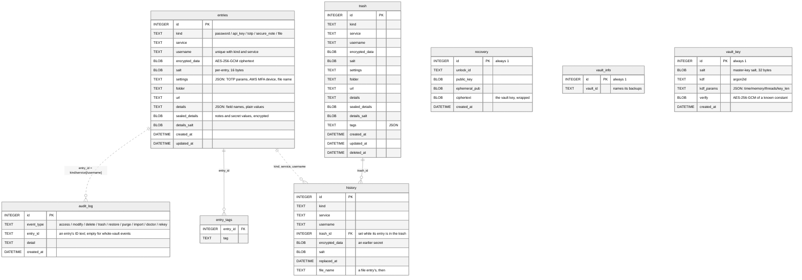

# sesh Architecture

This document describes the system architecture for sesh, a command-line credential management and authentication system.

## Contents

1. [Architectural Principles](#architectural-principles)
2. [Architectural Layers](#architectural-layers)
3. [Component Deep Dive](#component-deep-dive)
4. [Data Flow Architecture](#data-flow-architecture)
5. [Security Architecture](#security-architecture)
6. [Extensibility Model](#extensibility-model)
7. [Error Handling](#error-handling)
8. [Testing Strategy](#testing-strategy)
9. [Performance Design](#performance-design)
10. [Implementation Details](#implementation-details)
11. [Summary](#summary)

## Architectural Principles

The sesh architecture is based on four core design principles:

### 1. One Vault, One Command Line

Every kind of secret (passwords, API keys, notes, TOTP keys, files) lives in one encrypted vault, and every command works on all of them. Commands are verbs: `sesh list`, `sesh copy`, `sesh add`. A command names an entry by a few words, matched as the terminal app's search matches them, or by its ID. AWS sign-in is the one integration with a flow of its own (`sesh aws`), kept behind a small provider interface.

- Users learn one way to name an entry, the same in the app and on the command line
- A kind of entry is a filter (`sesh list notes`), not a separate mode
- Each command is one function, `runX(app, args)`, with its flags, help and completion beside it

### 2. Component Isolation

Each component accesses only what it needs — nothing more. Secrets reach other programs on stdin or in the environment, and memory is zeroed after use.

- Secrets are passed to other programs on stdin (the clipboard tools) or in the environment (`sesh run`, the AWS subshell), not as arguments. The one exception is the AWS one-time MFA code, which the AWS CLI takes only as `--token-code`
- The AWS shell's startup files (sesh's helpers and prompt prefix around the user's own; never the credentials) are written to temporary files and removed when it ends, a hangup included
- Each entry's secret is encrypted bound to its entry's ID (kind, name, username), so secrets can't be swapped between entries
- Secrets spend minimal time in memory

### 3. Terminal-Native Workflow

Terminal users shouldn't need to context-switch to graphical tools. Subshells provide isolated environments, clipboard integration handles quick pastes, and all operations are scriptable.

- No dependency on phones or browsers
- Reduces friction in automated workflows
- Scriptable from end to end

### 4. Interface-Driven Design

External dependencies are abstracted for testability. The vault, the AWS CLI, and TOTP generation sit behind formal interfaces with mock implementations. Other dependencies (clipboard, QR scanning, command execution) use replaceable package-level variables (`var execCommand = exec.Command`) for the same purpose.

- Unit tests can mock any external system
- Implementations can be swapped (e.g., an in-memory store in tests)
- Code stays loosely coupled

## Architectural Layers

The architecture follows a strict layering model where dependencies flow downward:

```
┌──────────────────────┐     ┌─────────────────────────────┐
│   Command Layer      │────▶│   Core Layer                │
│   sesh/cmd/sesh/     │     │   internal/                 │
│                      │     │                             │
│ • Commands (verbs)   │     │ • password: entries, search,│
│ • Words → one entry  │     │   sesh's export and import  │
│ • Flags, help,       │     │ • tui: sesh ui              │
│   completion         │     │ • provider/aws, setup:      │
│ • Subshell           │     │   AWS sign-in               │
└──────────────────────┘     └─────────────────────────────┘
           │                                │
           └────────────────┬───────────────┘
                            │
               ┌────────────▼────────────┐
               │   Infrastructure Layer  │
               │      internal/          │
               │                         │
               │ • Vault (SQLite,        │
               │   encrypted), agent     │
               │ • Key settings, Touch ID│
               │   recovery key          │
               │ • Backups, imports      │
               │ • TOTP generation       │
               │ • Secure memory         │
               │ • Clipboard, QR codes   │
               │ • AWS CLI integration   │
               └─────────────────────────┘
```

### Layer Responsibilities

**Command Layer**: what the user types
- One function per command, dispatched from the first word
- Turns words into one entry (`resolve.go`), asking which at a terminal when several match
- Keeps the vault's meaning out of flag parsing

**Core Layer**: what sesh does with entries
- The password manager core: listing, ranked search, sesh's own export and import, password generation and strength
- The terminal app
- AWS sign-in: exchanging an MFA code for temporary credentials

**Infrastructure Layer**: Shared utilities
- Eliminates code duplication
- Centralizes security operations
- Provides consistent behavior

## Component Deep Dive

### Command Layer

**Design Decisions:**

1. **Separation of Concerns**:
   - `main.go` takes the setting flags (`--db-path`), then runs the command the first word names, from its `commands` table; plain `sesh` prints the overview
   - Each command parses its own flags, wherever they are among its words (`parseAnywhere`), and opens the vault itself, so a mistyped command never unlocks or creates one
   - `resolve.go` turns words into an entry: an exact ID, or the search's matches, with a numbered question at a terminal when there are several
   - `app_subshell.go` isolates subshell complexity

2. **Dependency Injection**:
   ```go
   func NewDefaultApp(versionInfo VersionInfo, settings AppSettings) *App
   ```
   The app holds the streams, the clipboard, and the settings commands use; it doesn't hold the vault. A command opens the vault with the settings resolved through `internal/config` (flag > env > `~/.config/sesh/config.toml` > default). Tests substitute the streams, the clipboard, and the terminal check.

3. **Words, not IDs**: every command that takes an entry shares one rule. The words are matched as `sesh ui`'s search matches them (name, username, and URL host, anywhere in them; a kind word such as `totp` narrows). One match is used; several are asked about at a terminal, and listed by ID otherwise. A full ID, spaces and all, matches only that entry. Commands that act on several entries (`sesh trash`, `sesh folder move`, `sesh tag add`) take several IDs, or words naming one.

### The AWS Provider

AWS sign-in is the one flow with steps of its own: an MFA code exchanged with AWS STS for temporary credentials, opened in a subshell. `sesh aws` builds the provider, parses its flags, then hands it the vault:

```go
type ServiceProvider interface {
    Name() string
    SetupFlags(fs FlagSet) error
    GetCredentials() (Credentials, error)
    GetClipboardValue() (Credentials, error)
    ValidateRequest() error
    GetFlagInfo() []FlagInfo
}
```

1. **Lifecycle**: setup flags → validate the request → get credentials (or, with `--clip`, only the code).

2. **Output Mode Abstraction**: Separate methods for `GetCredentials()` and `GetClipboardValue()` keep clipboard mode from ever calling STS, which would use up the one-time code.

**Optional Interface Pattern**

The subshell is a capability a provider may have; `LaunchSubshell` discovers it at run time:

```go
type SubshellProvider interface {
    NewSubshellConfig(creds *Credentials) interface{}
}
```

This pattern (following Go's composition model) provides:
- Capability declaration via interfaces
- Runtime feature discovery
- Non-breaking capability additions

### Infrastructure Components

Infrastructure components implement the following security controls:

#### Credential Storage

Every entry lives in one encrypted vault, a SQLite file:

- Pure-Go SQLite via `modernc.org/sqlite`: the vault needs no C library. Only the macOS build uses cgo, for Touch ID and the screen-lock check
- AES-256-GCM encryption with per-entry salts
- Argon2id key derivation for per-entry keys (from the master key and the entry's salt: 1 pass, 16 MiB)
- Search by name, username, or the URL's host, matching any part and ignoring case
- Audit log table tracking all access, modifications, and deletions
- A master key derived from the master password (see below)
- WAL mode for concurrent read safety
- The vault's key record (`vault_key` table): what the master password is turned into the key with

**The master key.** `database.MasterPasswordSource` derives the 256-bit master encryption key from the master password via Argon2id. The KDF salt, Argon2id parameters, and a verification blob are the vault's key record, one row in the database's `vault_key` table, so the vault is one file. The verification blob is AES-256-GCM ciphertext of a known constant; on unlock, GCM's authentication tag rejects wrong passwords immediately. It works the same on macOS and Linux. In normal use the sesh agent holds the derived key and the store encrypts through it (`agent.Oracle`).

**Unlocking.** Every command that opens the vault gets its key source from `main.go`'s `buildKeySource(cfg)`:

1. It reads the vault's key record, which needs no key. With no record yet (the first run), it makes one: from `SESH_MASTER_PASSWORD` when that's set, otherwise from a new master password asked for twice, which then also unlocks the agent; at a terminal it also offers a recovery key and Touch ID.
2. With `SESH_MASTER_PASSWORD` set, the agent is never used: the key is derived in this process on every run.
3. Otherwise it connects to the agent, starting one if needed. If the agent already holds this vault's key (matched by the vault's unlock id, a SHA-256 of the verify blob), the store encrypts through it (`agent.Oracle`).
4. If not, at a terminal it tries Touch ID first when it's on, then asks for the master password, up to 3 tries. The agent is sent the password with the vault's salt, Argon2id settings and verify blob, and derives and checks the key itself.
5. If the agent can't be reached, or fails, the key is derived in this process from the master password, asked for if it hasn't been (`MasterPasswordSource`, wrapped as an oracle).

The store only sees a `database.CryptoOracle`, so it doesn't know whether the agent or this process holds the key. After opening, it checks the file's key record is still the one the key was checked against, so a password changed by another command meanwhile is noticed.

**The agent** (`internal/agent`, `sesh agent`) holds the derived key between commands:

- A per-user Unix socket, `<user cache dir>/sesh/agent.sock` (`SESH_AUTH_SOCK` overrides), mode 0600 in a private folder. Each end checks the other is the same user.
- Newline-delimited JSON, protocol version 2, a `hello` first; messages are capped at 4 MiB. Requests: `ping`, `status`, `unlock`, `unlock_touchid`, `encrypt`, `decrypt`, `wrap_key` (for Touch ID and the recovery key), `touch` (from `sesh ui`, so the idle timer doesn't run out while it's used), `lock`, `stop`. Every `encrypt` and `decrypt` names the vault's unlock id, so one vault's key never serves another.
- It refuses to start unless it can turn off core dumps, refuse debuggers (`PT_DENY_ATTACH` on macOS, `PR_SET_DUMPABLE=0` on Linux), and keep the key in a memory page locked into RAM.
- It locks after `agent.idle_timeout` (10 minutes) without use, at `agent.max_lifetime` (8 hours), when the computer sleeps, and when the Mac's screen locks; once it has locked by itself it exits: at once when its own 15-second check finds the lock, otherwise (a lock found as a command arrives, or a screen lock) if nothing unlocks it within the idle timeout. Commands start it as needed, and one from another sesh build is replaced.

See [SECURITY_MODEL.md](SECURITY_MODEL.md#sesh-agent) for what it protects against, and what it doesn't.

**Encrypted export.** The password manager's `ExportEncrypted`/`ImportEncrypted` use the same primitives (Argon2id + AES-256-GCM) but with an independent per-export salt. The envelope is self-contained — the salt and parameters are embedded alongside the ciphertext — so encrypted exports are portable across machines and master passwords.

**Entries.** Everything stores through `vault.Store` (`internal/vault`). An entry is keyed by its kind (`password`, `api_key`, `totp`, `secure_note`, `file`), name, and an optional username, unique together; its text form, `kind/name[/username]`, is the ID `sesh list` shows, every command that names an entry takes, and the audit log records. Non-secret options are its settings: a TOTP entry's code settings (algorithm, digits, period, issuer), for AWS the MFA device, and a file entry's file name. An entry also has a folder, tags, a URL, and notes and custom fields. Notes and secret field values are encrypted together, bound to the entry under their own tag (`sesh-details-v1`, where the secret uses `sesh-entry-v1` and an earlier secret `sesh-history-v1`), so they can't be swapped with its secret. Names, usernames, URLs, folders, tags, field names and plain field values are stored unencrypted, so they can be listed and searched. An AWS profile's MFA secret is the TOTP entry `aws` with the profile as username, so `sesh list totp` shows it.

**SQLite Data Model**

The vault is one SQLite file: `~/Library/Application Support/sesh/passwords.db` on macOS, `$XDG_DATA_HOME/sesh/passwords.db` (or `~/.local/share/sesh/passwords.db`) on Linux, or wherever the `db_path` setting says. Its schema is in `internal/database/schema.go`:

- `entries`, and `entry_tags` for their tags;
- `trash` (deleted entries, with their tags, kept for `trash.keep_days`) and `history` (earlier secrets, kept for `history.keep`; those of an entry in the trash go with it);
- `vault_key`, the one row an unlock reads before any entry;
- `recovery`, the vault's key wrapped for the recovery key, and `vault_info`, a random id that names its backups;
- `audit_log`, which names entries by their ID's text, with no foreign key, so the log survives an entry's deletion;
- `schema_migrations`.



#### TOTP Generation

**Dual Code Generation with Params**
```go
// Standard generation (6 digits, 30s, SHA1)
currentCode, nextCode, err := p.totp.GenerateConsecutiveCodesBytes(secret)

// Non-standard generation (respects stored algorithm, digits, period)
currentCode, nextCode, err := p.totp.GenerateConsecutiveCodesBytesWithParams(secret, params)
```
Generates both current and next codes to handle the transition between TOTP windows. When a TOTP entry is added from an `otpauth://` link or QR code, `totp.Params` (algorithm, digits, period, issuer) are extracted from the `otpauth://` URI and stored in the entry's settings. sesh reads these params before generating codes, falling back to defaults (SHA1, 6 digits, 30 seconds) when no params are stored.

#### Memory Management

Go's garbage collector prevents true secure erasure, but we reduce the exposure window:

1. Use `[]byte` over `string` for mutability
2. Zero immediately after use
3. Use `runtime.KeepAlive()` to prevent the compiler from optimizing away the zeroing
4. Pass secrets to other programs on stdin or in the environment, not as arguments (the AWS MFA code is the one exception)

#### Subshell Implementation

**Design**:
1. The user's own shell and startup files, with sesh's helpers defined first so the user's aliases can't change them: zsh through a temporary `ZDOTDIR` whose `.zshenv` defines them, hands `ZDOTDIR` back, and runs the user's `.zshenv`, after which zsh reads the system's and the user's files in its usual order; bash through `--rcfile`, which runs `~/.bashrc`; `sh` through `ENV`, which runs the user's own ENV file
2. `(sesh:aws)` before the prompt, put back by a prompt hook that, at the first prompt, moves itself after the user's own (and redraws that first prompt once the line is ready)
3. `SESH_ACTIVE` check prevents nesting
4. The vault is closed, and `SESH_MASTER_PASSWORD` left out, before the shell starts
5. The shell runs as `sesh run`'s commands do (`runChild`): a hangup is passed on, and a request to stop as a hangup (an interactive shell ignores SIGTERM); its exit status is sesh's
6. The credentials leave with the shell on exit (AWS still accepts them until they expire)
7. Built-in helper functions

**Subshell Advantages**
- Provides explicit credential lifecycle management
- Prevents pollution of main shell environment
- The MFA key read that starts it is recorded in the audit log (the subshell itself isn't)
- Visual indicators reduce operational security errors

### AWS Setup

`sesh aws setup` (`internal/setup`) stores a profile's MFA key. It checks who the profile signs in as, reads the key (typed, or from a QR code in an image file or on screen), and saves it before giving the codes that finish enrolling it in AWS, so nothing after can lose a key AWS uses. It then finds the profile's MFA device through the AWS CLI (`internal/aws`: authenticator apps only), and saves it with the key, filed where `--folder` and `--tag` say, or asks. A TOTP entry for anything else is added with `sesh add totp`, which takes the key typed, an `otpauth://` link, or a QR code (`--qr`).

## Data Flow Architecture

AWS and TOTP follow different flows because AWS requires a network round-trip to STS to exchange a TOTP code for temporary credentials, while TOTP is purely local computation. Both flows read secrets from the vault and route output through the same channels (stdout, clipboard, or subshell).

### AWS Authentication Flow

The mode decision happens in `sesh aws` *before* credential generation. Subshell and clipboard modes follow different code paths:

```
User ──► CLI ──► ValidateRequest
                      │
                      ├── Vault: look up the profile's entry
                      └── Check its code settings; warn if no MFA device
                      │
                ┌─────┴──────┐
                ▼            ▼
          --clip         default, or --no-subshell
                │            │
                ▼            ▼
        GetClipboardValue  GetCredentials
                │            │
                ▼            ├── Vault (MFA device, fallback to aws iam)
           Vault             ├── Vault (get TOTP secret)
          (get TOTP          ├── TOTP Engine → generate the current code
           secret)           ├── AWS CLI (sts get-session-token)
                │            │   └── refused: wait for the next code, try once
           TOTP Engine       ├── Parse expiry, build env vars
                │            ▼
                ▼       NewSubshellConfig ─── or, with --no-subshell,
          Copy code          │                print the exports (to eval)
         to clipboard   Launch subshell
                        (isolated env)
```

**Why it works this way:**

1. **Early branching**: Clipboard mode only generates a TOTP code — it never calls AWS STS. This avoids consuming the one-time code that the subshell path needs for authentication.

2. **AWS CLI delegation**: STS calls go through the `aws` CLI binary, inheriting region selection, profile configuration, and security updates without sesh needing the AWS SDK.

3. **Retry logic**: AWS takes each code once. If it refuses the current one (used in the last 30 seconds), GetCredentials waits for the next 30-second window and tries once with that window's code.

### TOTP Data Flow

TOTP is simpler: no network calls, no subshell. `sesh code`, `sesh copy` and `sesh get` share the same steps:

```
User ──► sesh code github ──► words → one TOTP entry (asks which, when several)
                                     │
                                     ├── Vault: its code settings
                                     ├── Vault: its key (recorded in the audit log)
                                     ├── TOTP Engine (RFC 6238)
                                     │   └── current + next codes
                                     ├── seconds left in the window
                                     ▼
                     code: print it, the time left, and near the end the next
                     copy: to the clipboard, cleared after clipboard_timeout
                     get:  print it, for a pipe
```

**TOTP implementation details:**

1. **Stateless**: Only needs the secret and current timestamp — no network, no session state
2. **Dual codes**: Generates both current and next window codes
3. **Defensive memory**: the key is zeroed once the codes are made

## Security Architecture

### Security Layers

Each layer provides independent security measures:

1. **Storage Security**
   - **Threat**: Someone with the vault file reading or swapping its secrets
   - **Defense**: Every secret encrypted (AES-256-GCM) under a key derived from the master password with Argon2id, and bound to its entry's ID, so it can't be moved to another entry unnoticed
   - **Not encrypted**: names, usernames, URLs, folders, tags, field names and plain field values

2. **Memory Security**
   - **Threat**: Core dumps, swap, another process of yours reading the agent's memory
   - **Defense**: Zeroing byte slices after use; the agent refuses to start without turning off core dumps, refusing debuggers, and a locked page for the key
   - **Not covered**: root, and cold-boot or DMA attacks (see SECURITY_MODEL.md)

3. **Process Security**
   - **Threat**: Secrets visible in `ps`, shell history, or logs
   - **Defense**: Secrets go to other programs on stdin or in the environment, not as arguments; the AWS MFA code, a one-time code, is the exception
   - **Security Principle**: Process arguments are public, stdin is private

4. **Session Security**
   - **Threat**: Credential leakage between sessions
   - **Defense**: Credentials only in the shell `sesh aws` starts, gone from it when it exits
   - **User Benefit**: Clear security boundaries

5. **Access Security**
   - **Threat**: Network interception, MITM attacks
   - **Defense**: No network code - delegate to AWS CLI
   - **Approach**: Delegate to established security implementations

### Trust Boundaries

Understanding where trust transitions occur:

```
User Input → [TRUST BOUNDARY] → sesh
    ↓
   sesh → [TRUST BOUNDARY] → Vault file
    ↓
   sesh → [TRUST BOUNDARY] → AWS CLI
    ↓
AWS CLI → [TRUST BOUNDARY] → AWS APIs

Additional trust boundaries:
   sesh → [TRUST BOUNDARY] → Agent socket (any process of yours can ask an unlocked agent to decrypt)
   agent → [TRUST BOUNDARY] → Secure Enclave (Touch ID unlock)
   sesh → [TRUST BOUNDARY] → Filesystem (temp shell init files, QR screenshot captures, backups,
                             sesh inject's output, --editor temp files, sesh run's file copies)
   sesh → [TRUST BOUNDARY] → Child processes (sesh run's environment; git, through the credential helper)
   sesh → [TRUST BOUNDARY] → Browser (sesh open, http and https only)
   sesh → [TRUST BOUNDARY] → Clipboard (pbcopy; wl-copy, xclip or xsel on Linux — visible to clipboard
                             managers; cleared after clipboard_timeout, 30s by default)
```

Each boundary represents:
- A potential attack surface
- A place where validation must occur
- A place for layered defenses

## Extensibility Model

### Adding a Command

A command is a function over the app and its arguments, with its help and flags beside it:

```go
// runX is sesh x: what it does.
func runX(app *App, args []string) error {
    fs := flag.NewFlagSet("x", flag.ContinueOnError)
    // its flags, through an addXFlags(fs) that completion also uses
    words, err := parseAnywhere(fs, args)
    // ...
    store, err := openFilingStore()             // the vault, only once the arguments are right
    k, err := resolveEntry(app, store, words, "") // words → one entry
    // ...
}
```

It's listed in `subcommands` (completion and the dispatcher read that), run from `commands`, and documented in `usage` (the overview) and the usage guide in the same change.

### Capability Evolution

Optional interfaces, discovered at run time by type assertion: `SubshellProvider`, which `LaunchSubshell` looks for, and `QuietProvider` and `ClipChecker`, which `app.go` looks for. (`sesh aws` asks its provider `ShouldUseSubshell()` directly.)

```go
type SubshellProvider interface {
    NewSubshellConfig(creds *Credentials) interface{}
}
```

## Error Handling

### Error Design Principles

1. **Context Over Codes**: Users need to know *what went wrong* and *how to fix it*
2. **Wrap Don't Replace**: Preserve error chains for debugging
3. **User-Friendly Top Layer**: Technical details in logs, actionable messages to users

### Error Flow Architecture

```go
// Layer 1: Infrastructure (Technical)
return fmt.Errorf("decrypt %s: %w", key, err)
// Preserves full error context for debugging

// Layer 2: Provider (Contextual)
return fmt.Errorf("failed to get session token: %w", err)
// Adds domain-specific context; the app adds "failed to generate credentials: "

// Layer 3: CLI (Actionable)
// Errors bubble up with full context; the CLI prints them directly
if err != nil {
    fmt.Fprintf(app.Stderr, "❌ %v\n", err)
    // Provider errors already include actionable hints, e.g.:
    // "no AWS entry found for profile (prod). Run 'sesh aws setup' first"
}
```

### Error Message Examples

- Cryptic: `sql: no rows in result set`
- Improved: `entry not found: totp/aws/prod`  
- Optimal: `no AWS entry found for profile (prod). Run 'sesh aws setup' first`

Errors become progressively more actionable as they flow up through layers.

## Testing Strategy

### Interface-Based Testing

Interface-based testing enables, for example with the AWS CLI's interface (`internal/aws`):
```go
type Provider interface {
    GetSessionToken(profile, serial string, code []byte) (Credentials, error)
    GetFirstMFADevice(profile string) (string, error)
}
```

- Millisecond execution
- Error path testing
- Parallel execution
- Offline operation

### The Test Helper Pattern

Commands sesh runs (the AWS CLI, clipboard tools) are replaced in tests. An in-process mock (`internal/testutil/exec_mock.go`) is preferred; where a real process is needed, `MockExecCommand` uses Go's test binary as one:

```go
func MockExecCommand(output string, err error) func(string, ...string) *exec.Cmd
```

The pattern uses the test binary itself as a mock process, eliminating:
- Shipping mock binaries
- Complex PATH manipulation  
- Platform-specific code

## Performance Design

sesh is a CLI tool — every invocation should feel instant. The design avoids unnecessary work:

- **Selective execution**: only the command the first word names runs, and it opens the vault only once its arguments are right. Plain `sesh`, `--help` and completion never unlock it.
- **No framework overhead**: Go's standard `flag` package for parsing, no logging framework in the hot path.

The dominant cost in any sesh invocation is unlocking the vault (deriving the key from the master password, unless the agent already holds it) and, for `sesh aws`, the network round-trip to AWS STS. The first command that opens the vault once the newest backup is `backup.every_days` old also makes the automatic backup: an integrity check and a copy of the vault file (a vault with no entries isn't backed up).

## Implementation Details

### Directory Structure as Architecture

```
sesh/
├── sesh/cmd/sesh/         # Command layer: one file per command or group
├── internal/              # Core implementation
│   ├── password/          # Listing, search, sesh's export and import, generation, strength
│   ├── tui/               # sesh ui
│   ├── provider/          # Flags shared by commands; the AWS provider
│   │   └── aws/
│   ├── setup/             # sesh aws setup
│   ├── aws/               # The AWS CLI: STS and the MFA device
│   ├── database/          # SQLite store, encryption, history, trash, audit log
│   ├── agent/             # The background agent that holds the key
│   ├── vault/             # Entries and the Store interface
│   ├── config/            # Settings: flags > environment > config file > defaults
│   ├── kdf/               # Argon2id settings and their bounds
│   ├── keywrap/           # Wrapping the vault key to a public key (P-256 ECDH, HKDF, AES-GCM)
│   ├── touchid/           # Touch ID unlock: a Secure Enclave key, touchid.key beside the vault
│   ├── recovery/          # The recovery key
│   ├── backup/            # Automatic and manual backups, next to the vault
│   ├── screenlock/        # Whether the Mac's screen is locked
│   ├── importer/          # Other apps' exports: bitwarden, browser, gauth, keepass, seshexport
│   ├── secretref/         # sesh://<id>[#field] references, for run and inject
│   ├── mask/              # Hiding secrets in sesh run's output
│   ├── health/            # The password health report
│   ├── totp/              # TOTP codes and otpauth:// links
│   ├── qrcode/            # Reading and drawing QR codes
│   ├── clipboard/         # The clipboard, cleared after a while
│   ├── exportfile/        # Writing an export whole
│   ├── atomicfile/        # Replacing a file safely
│   ├── subshell/          # The AWS subshell
│   ├── shell/, env/       # Shell quoting and environment helpers
│   └── secure/            # Memory security
└── docs/                  # Documentation
```

### Stakeholder Benefits

**Security Engineers:**
- Defined trust boundaries
- Explicit secret flow paths (vault → command → output, clipboard, or subshell) — no implicit or hidden data paths
- Layered security implementation
- An audit log of every secret copied, printed or revealed, every change and delete (`sesh audit`); codes drawn in `sesh ui`'s list aren't recorded

**Developers:**
- One function per command
- Isolated testing capabilities
- Established patterns
- Explicit interface contracts

**Users:**
- One way to name an entry, in the app and on the command line
- Predictable performance
- Default security configurations

## Summary

The architecture provides:

- **One model** for every kind of secret, and one way to name an entry
- **Security** via layered defense mechanisms
- **Simplicity** through clear separation of concerns
- **Performance** via efficient design patterns

New commands add to the command layer without touching the vault, and the vault's security invariants hold for every one of them.
