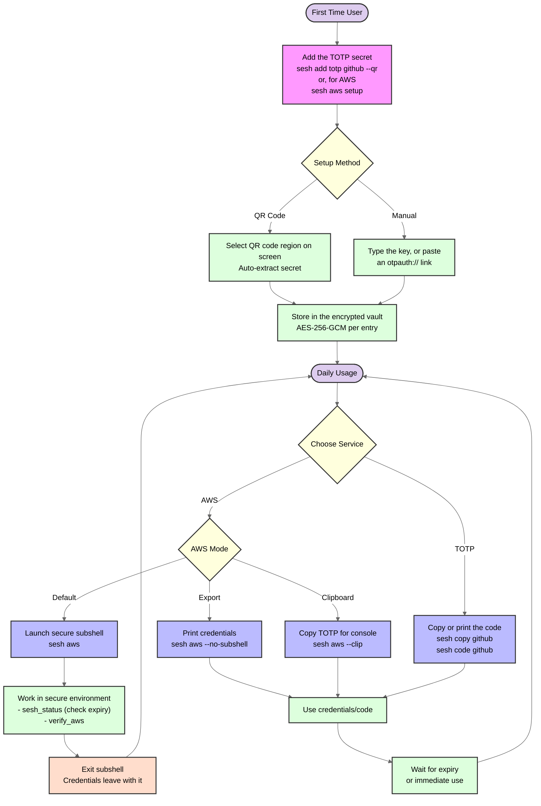
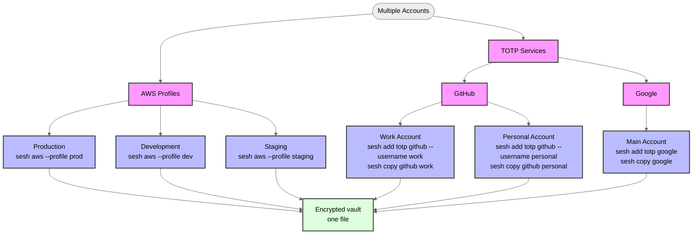

# sesh Usage and Configuration Guide

This document provides detailed instructions for using and configuring sesh: one encrypted vault for your passwords, API keys, notes and TOTP secrets, and AWS sign-in with your MFA code.

> **Requirements:** macOS or Linux. The vault, encrypted and unlocked with your master password, works the same on both; Touch ID unlock is macOS-only. For `sesh aws`, the [AWS CLI](https://docs.aws.amazon.com/cli/latest/userguide/getting-started-install.html) must be installed and configured.

## Workflow Overview

The diagram below shows the complete workflow for using sesh, from initial setup through daily usage:



## Before You Start

Have the QR code or TOTP secret ready **before** running setup:

- **For AWS MFA:** Open AWS Console → IAM → Your User → Security Credentials → MFA devices → Assign MFA device → Select "Authenticator app." AWS will display a QR code.
- **For GitHub 2FA:** Go to GitHub Settings → Password and Authentication → Enable Two-Factor Authentication → Choose "Set up using an app." GitHub will display a QR code.
- **For any TOTP service:** Navigate to the service's security/2FA settings and start the authenticator app setup flow. Look for a QR code or a base32 secret key.

Once you can see the QR code on screen, run `sesh add totp <name> --qr` (on macOS; elsewhere, save a screenshot and use `--qr-image FILE`, or type the key). For AWS, run `sesh aws setup`.

## Basic Usage

sesh's commands are verbs, with what they act on after them: `sesh <command> [words] [flags]`. They work on every kind of entry: passwords, API keys, notes and TOTP entries. The simplest way to start is to add an entry and use it:

```bash
# First time setup for AWS (have the AWS Console QR code visible on screen)
sesh aws setup

# ... or for any other TOTP site (have the site's QR code visible)
sesh add totp github --qr

# Store a password, typed hidden (--generate has sesh make one)
sesh add password github --username alice

# Daily usage - launch secure AWS subshell
sesh aws

# Copy a TOTP code to the clipboard
sesh copy github totp
```

This will:

1. **For AWS**: Launch a secure subshell with temporary credentials activated and MFA authenticated
2. **For TOTP**: Copy the current 6-digit code to the clipboard for immediate pasting into web forms; `sesh code github` prints it, with the seconds it has left

Plain `sesh` prints the overview: every command, grouped, and, before there's a vault, the first steps to take. `sesh --help` prints just the commands, and `sesh <command> --help` (for example `sesh copy --help`) shows each command's own help, with examples. Flags can go anywhere among the words: `sesh copy github --field pin` and `sesh copy --field pin github` are the same.

The flags of earlier versions of sesh (`--service`, `--action`, `--service-name`, `--list`, `--setup`, `--delete`, `--rekey` and the rest) are gone. Given one that named a command (`--service`, `--list`, `--delete`, `--setup`, `--clip`, `--rekey`, `--list-services`), sesh says what replaced it; any other flag in place of a command points to `sesh --help`:

```
$ sesh --rekey
❌ sesh has no --rekey: sesh passwd
$ sesh --delete password/github/alice
❌ sesh has no --delete: sesh trash <entry>
$ sesh --action get
❌ sesh takes a command first, not "--action"; the commands are listed by: sesh --help
```

sesh replaces mobile and desktop authenticator apps like Authy and Google Authenticator. It works with any service that supports the standard TOTP protocol (RFC 6238).

When assessing what will work with sesh, look for these signs:
- "Works with Google Authenticator" ✅
- Shows a QR code during setup ✅
- Offers "manual entry" option ✅
- Mentions "TOTP" or "RFC 6238" ✅
- Says "enter 6-digit code" ✅

Potential red flags for compatibility are the same one would face with Authy or Google Authenticator:
- "SMS only" ❌
- "Use our app only" ❌
- "Push notification required" ❌

## Naming an Entry

Every command that takes an `<entry>` (`copy`, `get`, `code`, `show`, `open`, `edit`, `trash`, `history`, `folder move`, `tag add`, ...) takes it the way `sesh ui`'s search finds it: a few words.

- **Words** are matched as [`sesh search`](#searching) matches them: any part of the entry's name, username, or its URL's host, in any case. A kind word narrows: `github totp` is GitHub's TOTP entry, `github password` its password, `stripe key` the API key. `github alice` is GitHub as alice.
- **An ID** names one entry exactly: its kind, name, and username if it has one, such as `password/github/alice` or `totp/google`. `sesh list` and `sesh search` show each entry's ID. A name with spaces works typed as one word or several: `sesh get "password/My Bank/me"` and `sesh get password/My Bank/me` are the same.
- **One match** is used.
- **Several matches,** at a terminal, are listed, numbered, and sesh asks which:

  ```
  $ sesh copy github
  "github" matches 2 entries:
    1  github (alice)  TOTP
    2  github (alice)  password
  Which one? [1-2, Enter to cancel]: 2
  ✅ Copied github (alice)'s password; the clipboard clears in 30s
  ```

  Without a terminal, as in a script, nobody can answer, so it's an error that lists their IDs:

  ```
  $ sesh get github
  ❌ "github" matches 2 entries; name one by its ID:
    totp/github/alice
    password/github/alice
  ```

- **No match** is an error: `no entry matches "nothing-here"; sesh search finds entries by any part of their name or username`. An ID that misses only by case says which entry you may have meant.

Commands that change or delete say which entry they're about to act on before they ask, so words that matched something unexpected are seen first. `sesh trash`, `sesh folder move` and `sesh tag add|remove` can act on several entries at once: give their IDs, one each. Words name one entry.

**Names.** An entry is named by its name and, optionally, a username (for an AWS MFA entry, the profile). Spaces inside a name are fine (`My Bank`). sesh refuses a name with:

- a `/`, which separates the parts of an entry's ID (`password/github/alice`), or a control character such as a tab or newline;
- a space at the start or end (`"github "`), which would make an entry that `github` doesn't find;
- an invisible character (such as a zero-width space or soft hyphen, which text copied from web pages can carry) anywhere in it, for the same reason. The characters emoji are built from (zero-width joiners, the tags in flags like Scotland's) are fine inside a name;
- a character that changes text direction, which can make one name display as another;
- more than 256 characters.

`sesh add` checks the name and username before the vault is opened, as does `sesh edit --rename` on an entry named by its ID, so a bad name is reported before the master password is asked for. A name read from a QR code or an `otpauth://` link is checked once it's read, the AWS setup checks the profile as soon as you enter it, and an import reports each entry it refuses and imports the rest.

Names are case-sensitive: `GitHub` and `github` are two entries. Words find either, since search ignores case; an ID that misses only by case is an error that says which entry you may have meant (`entry not found: password/github/Alice; did you mean password/github/alice? Names are case-sensitive`). Creating an entry whose name differs from an existing one only in case asks first, like an overwrite, with `sesh add` (`--force` skips the question). AWS profiles are named by your AWS configuration, so the AWS setup doesn't ask.

## Shell Completion

sesh can complete its commands, flags, and their values when you press Tab, in bash, zsh, and fish. `sesh completion bash`, `sesh completion zsh`, or `sesh completion fish` prints the script for that shell; your shell needs to load it. Shell setups vary a lot (dotfiles managers, `ZDOTDIR`, plugin managers, frameworks), so below is what each shell needs, with the usual places as examples. Put it wherever your setup keeps such things.

**Installed with Homebrew,** the scripts are already in Homebrew's completion folders, kept in step with each upgrade: turn on Homebrew's completion for your shell ([Homebrew's guide](https://docs.brew.sh/Shell-Completion)) and skip the rest of this section. A copy saved by hand as below would take the place of Homebrew's, and go stale on upgrade.

Otherwise there are two ways, for every shell:

- **Load it at startup**, with a line in a file your interactive shell reads. It's always in step with the installed sesh, at the cost of running sesh once per new shell.
- **Save it as a file** where your shell looks for completions. Nothing runs at startup. If a sesh upgrade ever changes the script, save it again. (The candidates themselves always come from the installed sesh, so new flags and values show up without that.)

**zsh**
- At startup: `eval "$(sesh completion zsh)"`, placed **after** your setup runs `compinit`. That's usually in `.zshrc`: `~/.zshrc`, or `$ZDOTDIR/.zshrc` if you set `ZDOTDIR`. Frameworks such as Oh My Zsh run `compinit` for you when they're sourced.
- As a file: save it as `_sesh` in a directory that's on your `fpath` **before** `compinit` runs, for example `sesh completion zsh > ~/.zfunc/_sesh` with `fpath=(~/.zfunc $fpath)` earlier in your config. `print -l $fpath` shows the directories. If you cache completions (`compinit -C`, or a `.zcompdump` that isn't rebuilt), delete the `.zcompdump` once so zsh notices the new file.

**bash**
- At startup: `eval "$(sesh completion bash)"` in the file your interactive bash reads. That's usually `~/.bashrc`; note that macOS Terminal starts login shells, which read `~/.bash_profile` instead (many setups source one from the other). Works with macOS's bash 3.2 and with newer bash.
- As a file: with the bash-completion package (version 2, which needs bash 4.2 or later), save it as `sesh` in its user directory, by default `~/.local/share/bash-completion/completions/sesh`. It loads on the first Tab after `sesh`.

**fish**
- At startup: `sesh completion fish | source`, in `config.fish` or a file in `conf.d/` (under `~/.config/fish/` by default).
- As a file: `sesh completion fish > ~/.config/fish/completions/sesh.fish`, or the `completions` directory under your fish config directory if you've moved it. fish loads it on the first Tab after `sesh`.

What completes:
- the commands (`list`, `copy`, `add`, `trash`, `agent`, ...) and theirs (`sesh agent st<Tab>` → `status`, `stop`; `sesh trash <Tab>` → `list`, `restore`, `remove`, `empty`; `sesh aws <Tab>` → `setup`);
- kinds: `sesh add <Tab>` → `password`, `key`, `note`, `totp`, `file`; `sesh list <Tab>` and `sesh export <Tab>` → `passwords`, `keys`, `notes`, `totp`, `files`;
- settings: `sesh config set <Tab>` → the setting names;
- each command's flags (`sesh copy --<Tab>` → `--field`, `--url`, `--username`);
- values from a fixed set: `--sort`, `--format`, `--from`, `--on-conflict`, and `sesh edit`'s `--type`;
- file paths for `--file`, `--db-path`, `--env-file`, `--qr-image`, `--from`, `-o` (`sesh get`, `sesh inject`), `sesh inject`'s `-i`, and the files `sesh import`, `sesh backup` and `sesh restore` take.

Entry names don't complete: that would mean opening the vault on a Tab press. Completion never reads the vault, the agent, or the config file.

## Configuration Methods

sesh is set up in these ways:

1. **Global flags** - Apply to every command (e.g., `--db-path`, `--help`)
2. **Command flags** - Apply only to their command (e.g., `--profile` for `sesh aws`); `sesh <command> --help` lists them
3. **Config file** - Persistent settings in `~/.config/sesh/config.toml` (see [Configuration file](#configuration-file))
4. **Environment variables** - Override the config file for one shell or one command (e.g. `SESH_DB_PATH`)
5. **Credential storage** - An encrypted vault, unlocked with your master password

### Configuration file

sesh reads `~/.config/sesh/config.toml` on macOS and Linux (`$XDG_CONFIG_HOME/sesh/config.toml` when `XDG_CONFIG_HOME` is set). The file is optional, and every setting in it is optional:

```toml
db_path           = "~/vaults/sesh.db"  # where your vault lives: absolute, or starting with ~/
clipboard_timeout = "30s"               # how long a copied secret stays on the clipboard

[agent]
idle_timeout = "10m"                    # 0 disables
max_lifetime = "8h"                     # 0 disables
lock_on_sleep = true                    # lock when the computer sleeps
lock_on_screen_lock = true              # lock when the screen locks (macOS)

[audit]
retention_days = 90                     # days of audit log events to keep; 0 keeps everything

[trash]
keep_days = 30                          # days a deleted entry stays in the trash; 0 deletes for good

[history]
keep = 10                               # earlier secrets kept for each entry: 0 to 1000

[backup]
every_days = 1                          # back up when the newest backup is this many days old; 0 turns it off
keep = 7                                # how many backups to keep
dir = "~/Backups/sesh"                  # where they go (default: a backups folder next to the vault)

[health]                                # what sesh health checks
old_after_days = 365                    # a password or API key unchanged this long is old; 0 doesn't check

[ui]
lock_on_quit = false                    # quitting sesh ui leaves sesh unlocked (default: true, it locks)

[sync]
auto = false                            # commands don't sync on their own; only sesh sync does (default: true)

[master_password]                       # how hard your master password is to guess-check (Argon2id)
memory = "256MiB"                       # memory each check takes: 19MiB to 1GiB
time = 3                                # passes over that memory: 2 to 10
threads = 4                             # 1 to 16
```

The `master_password` settings make each guess at your master password cost an attacker memory and time; higher is slower for them, and for you at each unlock. They're stored in the vault when it's created, and each `sesh passwd` stores the ones configured then, so changing them affects a vault only from its next password change, and never stops it from opening. In a vault that syncs, the change, and so the settings, reach the other computers at their next sync. Encrypted exports use them too, and record them in the file. The least sesh accepts is OWASP's minimum for Argon2id (19 MiB, 2 passes, 1 thread).

sesh keeps one vault per user. `db_path` says where that vault lives; it isn't a way to keep several. To keep things apart inside it, use [folders and tags](#folders-and-tags), and usernames (`github` as `work` and as `personal`). If you do make a second vault, give it its own folder: Touch ID unlock is kept per folder. sesh refuses a `db_path` that points at another program's SQLite database, and leaves that file unchanged.

Each setting comes from, highest first: a command-line flag (`--db-path`; the agent's timeouts also have `sesh agent` flags), its environment variable, the config file, then the built-in default. An unknown key or an invalid value is an error that names the setting and where it came from. A typo is never silently ignored.

`sesh init` writes the file for you. It's optional: with no config file, sesh uses an encrypted vault in the default location. It asks where the vault goes, then creates it, so setup ends ready to use:

```
$ sesh init
Vault location [~/Library/Application Support/sesh/passwords.db]: ~/vaults/sesh.db
Creating your sesh vault (first run)
  ...
Create master password: ****
Confirm master password: ****
Wrote ~/.config/sesh/config.toml
Ready. Run `sesh config` to see your settings.
```

- For scripts, give the location as a flag: `sesh init --db-path ~/vaults/sesh.db`. The master password for the new vault then comes from `SESH_MASTER_PASSWORD`.
- An existing config file is never replaced without `--force`.
- A new vault gets the `master_password` settings from `SESH_KDF_*`, or the defaults: the file init writes doesn't set them, so the vault matches what `sesh config` shows afterwards. Add them to the file later and run `sesh passwd` to apply them.
- An existing vault at the chosen location is opened, not recreated. If it can't be opened (it's damaged, say), init stops and writes nothing.

`sesh config` prints each effective setting and where it came from:

```
config file: /Users/me/.config/sesh/config.toml

clipboard_timeout          30s           (default)
agent.idle_timeout         25m           (config file)
agent.max_lifetime         8h            (default)
agent.lock_on_sleep        on            (default)
agent.lock_on_screen_lock  on            (default)
audit.retention_days       90 days       (default)
master_password.memory     256MiB        (default)
master_password.time       3             (default)
master_password.threads    4             (default)
backup.every_days          1 day         (default)
backup.keep                7             (default)
trash.keep_days            30 days       (default)
history.keep               10            (default)
health.old_after_days      365 days      (default)
ui.lock_on_quit            on            (default)
db_path                    /Users/me/vaults/sesh.db
                           (config file)
backup.dir                 /Users/me/vaults/backups
                           (default: next to the vault)
sync.dir                   off           (default)
sync.name                  laptop        (default: this computer's name)
sync.auto                  on            (default)
```

`sesh config set <key> <value>` changes one in the config file, as `sesh ui`'s settings panel does, and makes the file if there isn't one yet: the value is checked as sesh checks it when it loads, and the file keeps its comments and order (a linked one, from a dotfile manager, is changed where it lives). An empty value (`sesh config set history.keep ""`) takes the setting out of the file, back to its default. It says when the change takes effect. Lowering a setting that deletes as it goes (`history.keep`, `trash.keep_days`, `audit.retention_days`, `backup.keep`) asks first, saying what will go; `--force` changes it without asking, and is needed without a terminal. A setting an environment variable or a flag gives wins over the file, so it's refused here: change it there. `db_path` is changed by [moving the vault](#moving-the-vault).

```
$ sesh config set clipboard_timeout 15s
✅ Set clipboard_timeout to 15s in ~/.config/sesh/config.toml; it takes effect for other commands now, and in sesh ui from its next start
```

## Configuration Options

### Global Options

| Flag               | Description                                        |
|--------------------|----------------------------------------------------|
| `--help`           | Show every command; `sesh <command> --help` shows that command's own help |
| `--version`        | Display version information                        |
| `--db-path <path>` | Vault location for this command (overrides `SESH_DB_PATH` and the config file); it can go anywhere on the line |

### Commands and Their Flags

**Reading entries.** An `<entry>` is a few words, or an ID (see [Naming an Entry](#naming-an-entry)).

| Command | What it does | Flags |
|---------|--------------|-------|
| `sesh list [passwords\|keys\|notes\|totp\|files]` | Every entry, or those of the kinds named | `--folder F`, `--tag T` (only those in the folder and its subfolders, `""` for none; only those with the tag; repeat it to need all of them), `--sort name\|created\|updated\|folder`, `--json` |
| `sesh search <words>` | The entries matching the words, best first | `--folder F`, `--tag T`, `--json` |
| `sesh copy <entry>` | Copies its password, API key or note, a TOTP entry's current code, or a file entry's text; the clipboard clears after `clipboard_timeout` | `--username`, `--url`, or `--field NAME` (a custom field, or `notes`) copies that instead |
| `sesh get <entry>` | Prints the same, for a pipe or a script; a file entry's file exactly as kept | `--username`, `--url`, `--field NAME`, as for copy; `--json`; `-o FILE` writes it to a file readable only by you |
| `sesh code <entry>` | Prints a TOTP entry's current code, and how long it has left | `--json` |
| `sesh show <entry>` | Shows the entry: its URL, folder, tags, notes and fields, with secrets hidden | `--reveal` shows them; `--json`; for a TOTP entry, `--qr` draws its key as a QR code for a phone, `--uri` prints its `otpauth://` link |
| `sesh open <entry>` | Opens its URL in the browser (http and https only) | |

**Changing entries.**

| Command | What it does | Flags |
|---------|--------------|-------|
| `sesh add password\|key\|note\|totp\|file [<name>]` | Adds an entry. The secret is typed hidden, or piped in; a TOTP entry's key can be an `otpauth://` link; a file entry keeps a file whole | `--from FILE` (a file entry's file, which names it unless a name is given); `--username U`; `--generate [--length N] [--no-symbols]` or `--generate --words N [--separator S] [--capitalize]` (a password or passphrase, copied as it's saved); `--qr` (a TOTP key from a QR code on screen) or `--qr-image FILE` (from one in a PNG or JPEG); `--folder F`, `--tag T`; `--url U`, `--notes [--editor]`, `--field name=value`, `--secret-field name`; `--force` replaces an entry of that name without asking |
| `sesh edit <entry>` | Renames it, or changes its username, kind, secret, URL, notes or fields | `--from FILE` (a file entry's new file); `--rename N`, `--username U`, `--type password\|api_key\|secure_note`, `--secret`, `--generate [--length N] [--no-symbols]` or `--generate --words N [--separator S] [--capitalize]`, `--url`, `--notes [--editor]`, `--field`, `--secret-field`, `--remove-field`, `--rename-field old=new`, `--plain-field name`, `--force` |
| `sesh generate` | Prints a new random password, stored nowhere | `--length N` (default 24), `--no-symbols`; or a passphrase: `--words N` (3 to 20), `--separator S` (default `-`), `--capitalize`; `--copy` copies it instead |
| `sesh trash <entry>…` | Moves entries to the trash; asks first | `--purge` deletes for good; `--force` doesn't ask |
| `sesh trash list\|restore\|remove\|empty` | The trash: see [The trash](#the-trash) | |
| `sesh history <entry>` | Its earlier secrets: see [Password history](#password-history) | `--show N`, `--clip N`, `--restore N`, `--forget N,...` |
| `sesh folder move\|rename\|list`, `sesh tag add\|remove\|rename\|list` | Folders and tags: see [Folders and tags](#folders-and-tags) | |

**The vault.**

| Command | What it does | Flags |
|---------|--------------|-------|
| `sesh export [passwords\|keys\|notes\|totp\|files]` | Writes the entries to an export: see [Encrypted exports](#encrypted-exports) | `--file F` (default: the output), `--format encrypted\|json\|csv` (default encrypted), `--folder F`, `--tag T`, `--force` replaces a file |
| `sesh import --from <source> <file>...` | Brings entries over from another app, or a sesh export | `--dry-run`, `--yes`, `--on-conflict skip\|overwrite` |
| `sesh lock` | Locks sesh: the next command asks for the master password | |
| `sesh passwd` | Changes the master password | |

`sesh backup`, `sesh restore`, `sesh health`, `sesh doctor`, `sesh audit`, `sesh recovery`, `sesh recover`, `sesh touchid`, `sesh agent`, `sesh run`, `sesh inject`, `sesh git-credential` and `sesh ui` each have their own section below; `sesh config` and `sesh init` are in [Configuration file](#configuration-file).

### AWS Options (`sesh aws`)

| Command Flag       | Environment Variable | Description                             | Default Value    |
|--------------------|----------------------|-----------------------------------------|------------------|
| `--profile`        | `AWS_PROFILE`        | AWS profile to use                      | default profile  |
| `--no-subshell`    | n/a                  | Print credentials instead of subshell   | false (subshell) |
| `--clip`           | n/a                  | Copy the MFA code for the AWS console   | false            |
| `--folder`, `--tag` | n/a                 | With `sesh aws setup`: the folder to file the entry in, and a tag to add; repeat `--tag` for more | none |

**Profile precedence:** `--profile` flag > `$AWS_PROFILE` > `$AWS_DEFAULT_PROFILE` (as the AWS CLI reads them) > `"default"`. If none is set, sesh uses the profile named `"default"`.

### Environment Variables

| Variable                | Description                                        | Default          |
|-------------------------|----------------------------------------------------|------------------|
| `AWS_PROFILE`          | Default AWS profile (`AWS_DEFAULT_PROFILE` when it's unset) | `default`        |
| `SESH_DB_PATH`         | Vault location (config: `db_path`) | `~/Library/Application Support/sesh/passwords.db` (macOS), `$XDG_DATA_HOME/sesh/passwords.db`, or `~/.local/share/sesh/passwords.db` when that's unset (Linux) |
| `SESH_CLIPBOARD_TIMEOUT` | How long a copied secret stays on the clipboard (config: `clipboard_timeout`) | `30s` |
| `SESH_MASTER_PASSWORD` | Non-interactive master password (skips prompt). Intended for CI/scripting only — exposes the password via process environment | unset            |
| `SESH_AUTH_SOCK`       | Socket path for the sesh agent | `<user-cache-dir>/sesh/agent.sock` |
| `SESH_AGENT_IDLE_TIMEOUT` | Agent locks after this long without use; `0` disables (config: `agent.idle_timeout`). Same as `sesh agent --idle-timeout` | `10m` |
| `SESH_AGENT_MAX_LIFETIME` | Agent locks this long after each unlock; `0` disables (config: `agent.max_lifetime`). Same as `sesh agent --max-lifetime` | `8h` |
| `SESH_AGENT_LOCK_ON_SLEEP` | `false`: the agent doesn't lock when the computer sleeps (config: `agent.lock_on_sleep`); read by the command that starts the agent | `true` |
| `SESH_AGENT_LOCK_ON_SCREEN_LOCK` | `false`: the agent doesn't lock when the screen locks, on macOS (config: `agent.lock_on_screen_lock`); read by the command that starts the agent | `true` |
| `SESH_AUDIT_RETENTION_DAYS` | Days of audit log events the vault keeps; `0` keeps everything (config: `audit.retention_days`) | `90` |
| `SESH_BACKUP_EVERY_DAYS` | Back up when the newest backup is this many days old; `0` turns automatic backups off (config: `backup.every_days`) | `1` |
| `SESH_BACKUP_KEEP` | How many backups to keep, 1 to 1000 (config: `backup.keep`) | `7` |
| `SESH_BACKUP_DIR` | Where backups go (config: `backup.dir`) | a `backups` folder next to the vault |
| `SESH_TRASH_KEEP_DAYS` | Days a deleted entry stays in the trash; `0` keeps none, so deleting is for good (config: `trash.keep_days`) | `30` |
| `SESH_HISTORY_KEEP` | How many earlier secrets each entry keeps, 0 to 1000; `0` keeps no new ones (config: `history.keep`) | `10` |
| `SESH_HEALTH_OLD_AFTER_DAYS` | Days a password or API key can go unchanged before `sesh health` calls it old; `0` doesn't check (config: `health.old_after_days`) | `365` |
| `SESH_UI_LOCK_ON_QUIT` | `false`: quitting `sesh ui` leaves sesh unlocked; `true` locks it, as `sesh agent lock` does (config: `ui.lock_on_quit`) | `true` |
| `SESH_SYNC_DIR` | The sync folder the vault syncs with (config: `sync.dir`; set by `sesh sync init` and `join`, held to the same rules when set by hand) | none: the vault doesn't sync |
| `SESH_SYNC_NAME` | This computer's name in what it syncs (config: `sync.name`) | the computer's own name, without `.local` |
| `SESH_SYNC_AUTO` | `false`: commands don't sync on their own, only `sesh sync` does (config: `sync.auto`) | `true` |
| `SESH_KDF_MEMORY` | Memory for each master password check, such as `256MiB` (config: `master_password.memory`) | `256MiB` |
| `SESH_KDF_TIME` | Passes over that memory (config: `master_password.time`) | `3` |
| `SESH_KDF_THREADS` | Threads (config: `master_password.threads`) | `4` |

## The Vault and Its Key

Every secret lives in one encrypted vault file (SQLite, each entry encrypted with AES-256-GCM). Its key is derived from your master password via Argon2id, with the salt and settings kept in the vault file too, so the vault is that one file. It works the same on macOS and Linux. `sesh passwd` changes the master password.

### Using the master password

```bash
# First run — explains what it's creating, then asks for the new password twice
sesh add password github --username alice
# Creating your sesh vault (first run)
#   Location: ~/Library/Application Support/sesh/passwords.db
#   Your master password encrypts everything in the vault. sesh can't
#   reset it: if you forget it, only a recovery key opens the vault ...
# Create master password: ****
# Confirm master password: ****
# Make a recovery key, in case you forget your master password? [Y/n]
# Unlock with Touch ID instead of typing your password? [Y/n]     (macOS)
# Password for github (alice): ****
# ✅ Added github (alice)

# Later runs — no prompt while the agent is unlocked
sesh list

# After the agent has locked itself (10 minutes unused) — one prompt, then quiet again
sesh list
# Master password: ****
```

A new master password (at first run, `sesh passwd`, or `sesh recover`) must be at least 8 characters, and is rated the way stored passwords are (see "Weak passwords"). If it's easy to guess, sesh warns and asks `Use it anyway? [y/N]`; answering no, or just pressing Enter, asks for a different one. With `SESH_MASTER_PASSWORD`, nobody can answer, so sesh only warns.

Creating the vault also unlocks the background `sesh agent` with the new password, so the next command doesn't ask again. See [Using the sesh agent](#using-the-sesh-agent) for how it starts, locks, and stops.

Secrets are limited to 1 MiB each.

Next to the encrypted entries, the vault file holds the KDF salt, the Argon2id settings, and a verification blob (not a password hash): nothing secret, and everything needed to unlock it with your password. With no sesh command running, copying `passwords.db` (and its `-wal` file, if a crash left one) copies everything your master password, or your recovery key, needs to open the vault.

#### Scripts and CI

For non-interactive use, set `SESH_MASTER_PASSWORD`. sesh then checks that password on every run, prints no first-run explanation, and doesn't use the agent, so a script never starts a background process or depends on one being unlocked. If you also use sesh interactively, your agent is unaffected; `sesh agent stop` still stops it if you want it gone. Because the variable exposes the password to the process environment, use it only where that's acceptable.

```bash
export SESH_MASTER_PASSWORD='...'
sesh list
```

#### Forgotten master password

sesh can't reset it for you: the master password derives the vault's key, sesh doesn't store it, and there's no server that could help. After three wrong attempts at a terminal, sesh says so and points to your options:

- **Use your recovery key**, if you made one (see [Recovery key](#recovery-key)). `sesh recover` asks for it, then for a new master password, and re-encrypts the vault:

  ```bash
  sesh recover
  ```

- **Restore from an encrypted export**, if you made one. Start a new vault (below), then import the export. It asks for the export's own password, which you chose when exporting:

  ```bash
  sesh import --from sesh backup.enc
  ```

- **Start over with an empty vault.** First stop the agent with `sesh agent stop`, and finish any other sesh command. Then move the vault aside **with every file that belongs to it**:
  - the database;
  - its SQLite `-wal` and `-shm` files, if present. After a crash they can hold changes not yet in the database, and SQLite would apply a leftover `-wal` file to the new vault;
  - `touchid.key`, if present. It belongs to the old vault, and the new one isn't offered Touch ID while it's there.

  `sesh config` shows the vault's path. Keep the old files together, in case the password comes back to you:

  ```bash
  cd ~/Library/Application\ Support/sesh     # Linux: ~/.local/share/sesh
  mkdir forgotten
  mv passwords.db* forgotten/
  mv touchid.key forgotten/                    # if it exists
  ```

  The next `sesh add` (or `sesh init`, or an import) creates a new vault. sesh never deletes a vault for you.

To avoid ending up here, make a recovery key, keep the master password somewhere safe, and make an encrypted export from time to time (see [Encrypted exports](#encrypted-exports)).

### Moving the vault

sesh has no command to move a vault; it takes a few steps:

1. Close `sesh ui` and any other sesh command that's running.
2. Move the vault file, any `-wal` and `-shm` files beside it (`passwords.db-wal`, `passwords.db-shm`), and `touchid.key` if it's there, to the new folder, one only you can read and write. If that folder holds a vault already, choose another: the lines below move nothing then, nor when a vault's `-wal` or `-shm` file is there (beside another vault, it would change it), and `mv -n` leaves any other file that's there alone, saying so.
   ```bash
   mkdir -p ~/Library/Application\ Support/sesh && chmod 700 ~/Library/Application\ Support/sesh   # Linux: ~/.local/share/sesh
   from=~/Dropbox to=~/Library/Application\ Support/sesh
   if [ -e "$to/passwords.db" ] || [ -e "$to/passwords.db-wal" ] || [ -e "$to/passwords.db-shm" ]; then
     echo "a vault, or its files, is there already: choose another folder"
   else
     for f in passwords.db passwords.db-wal passwords.db-shm touchid.key; do
       if [ -e "$from/$f" ]; then
         mv -n "$from/$f" "$to/"
         [ -e "$from/$f" ] && echo "$f not moved: the new folder has one already"
       fi
     done
   fi
   ```
3. Change `db_path` in the config file to the new place (`sesh config` shows the file and the value). If `SESH_DB_PATH` sets it, change that instead. `sesh init --force --db-path <new place>` also points sesh at the vault there, but writes a new config file: your other settings go back to their defaults.
4. Backups are kept in a `backups` folder beside the vault unless `backup.dir` says otherwise: move that folder too.
5. Touch ID unlock goes on working when `touchid.key` moves with the vault (it's tied to the vault, not its folder); if it didn't, turn it on again with `sesh touchid enable`.
6. `sesh doctor` checks the result.

### Recovery key

A recovery key is a code you write down when you set it up, like `7P1J-V5ED-HW31-B0KB-HF0A-R4ST-0S81`. If you forget your master password, it lets you set a new one. sesh offers to make one when it creates a vault; you can also make one at any time:

```bash
sesh recovery new       # make a recovery key (replaces an earlier one)
sesh recovery status    # does this vault have one, and since when
sesh recovery remove    # stop it from opening the vault
sesh recover            # forgot the master password? set a new one
```

**Making one.** sesh shows the key once, then asks you to type its last group. It's only saved after you do, so a key nobody wrote down never works. Store it the way you'd store a passport: on paper, away from the computer. sesh doesn't keep a copy and can't show it again.

**Using it.** `sesh recover` asks for the key (any case; dashes and spaces optional; it reads I or L as 1 and O as 0), checks it, and asks for a new master password. The vault is re-encrypted as for a password change, and Touch ID unlock keeps working. Then:
- the key you used stops working, because it's been taken out of its hiding place and typed in;
- sesh offers a new one right away. If you decline, `sesh recovery status` shows that the vault has none.
- in a vault that syncs, the new master password goes to the sync folder, as a change made with `sesh passwd` does, and the other computers ask for it at their next sync. If another computer changed the master password first, `sesh recover` takes that one instead: the recovery key opens this vault, and you type the new password the others use, so a computer that forgot its own isn't left out.

**What it means for security.** Anyone who has both your recovery key and your vault file can open the vault, with no other check, because sesh has no server to add one. That's why it's optional. It can't be guessed (128 random bits), but it can be found, so keep it away from the vault's computer. The vault keeps only the recovery key's public key and the vault key wrapped to it; without the written-down key they open nothing.

**If the key may have been seen,** run `sesh recovery remove`, then `sesh passwd` (in a vault that syncs, the removal reaches the other computers as the change does). Removing it stops the vault from opening with it, but a backup made while it was set still would; a password change gives the vault a new key, which no old backup's recovery key opens.

**In a vault that syncs,** one recovery key covers every computer:
- **Made on one computer,** it opens the vault on every computer syncing through the folder once each syncs (`sesh recovery new` sends it at once). Removed on one, or used with `sesh recover`, it stops working on all of them the same way.
- **Made on two computers before either saw the other's,** one is kept on every computer: the one already in the sync folder when the other computer made its own, or, for two made at the same moment, the same one everywhere, chosen by sesh. The other computer says, at its sync, that its own doesn't work: throw away the one written down there, or make a fresh one. `sesh recovery new` (and making one in `sesh ui`) looks at the folder first, so this only happens while a key is on screen, or with the folder out of reach.
- **After a master password change,** a computer taking it keeps the recovery key only as the sync folder has it under the new password; until then the one it had isn't kept, as someone who knew the old password could have put it there. Sync every computer soon after changing a master password that may have been seen, and make a new recovery key too (`sesh recovery new`): someone who knew the old password and could write the folder may have put theirs there before the change.
- **Restoring a backup** never brings back the backup's recovery key: the vault takes the one the other computers use at its next sync, so a key replaced since (perhaps because it was seen) doesn't return.
- **Waiting to be sent:** `sesh recovery status` and `sesh sync status` say when a key made or removed here hasn't reached the folder yet.

**Changes that affect it.**
- **Changing your master password** (`sesh passwd`) keeps the recovery key working, with no prompt.

### Touch ID unlock (macOS)

On a Mac with Touch ID, the agent can unlock with your fingerprint instead of your master password. When the agent has locked itself, the next command shows the macOS Touch ID sheet:

```
sesh
sesh is trying to unlock your vault.
Touch ID to allow this.
                          [ Type Password in Terminal ]
```

**Turning it on.**
- When you create a vault at a terminal (first run or `sesh init`), sesh asks once: `Unlock with Touch ID instead of typing your password? [Y/n]`.
- Otherwise, run `sesh touchid enable`. It asks for your master password if the agent is locked.
- `sesh touchid status` shows whether it's on and whether Touch ID is available here. `sesh touchid disable` turns it off.

**How it works.**
- sesh creates a key inside your Mac's Secure Enclave that only a currently enrolled fingerprint can use. The private key never leaves the chip.
- The agent wraps the vault key to it. The result is stored in `touchid.key`, next to the vault (0600).
- `touchid.key` is useless on any other Mac or without your finger.
- The unlock is immediate after the touch: the slow password key derivation doesn't run.

**Your master password still works**, and sesh falls back to it:
- **You press "Type Password in Terminal", or the fingerprint isn't recognised:** sesh asks for the master password in the terminal. The sheet itself never takes a password; in particular it doesn't accept your Mac's login password.
- **Over SSH:** sesh doesn't ask for a fingerprint, since the sheet would appear on the Mac's own screen. It asks for the master password.
- **Touch ID isn't available:** no sensor reachable (for example with the lid closed), or no enrolled fingerprint. sesh says so and asks for the master password.
- **Too many failed attempts locked Touch ID:** sesh asks for the master password until the Mac is unlocked with its password.
- **Scripts** (no terminal, or `SESH_MASTER_PASSWORD`) never wait on a fingerprint.

**Changes that affect it.**
- **Changing your master password** (`sesh passwd`) keeps Touch ID unlock working: sesh re-wraps the new key, with no prompt.
- **Adding or removing a fingerprint** in System Settings makes the Secure Enclave key unusable for good. sesh notices before showing the sheet: it says your fingerprints changed, turns Touch ID unlock off, and asks for the master password. Turn it back on with `sesh touchid enable`.

Only a fingerprint approves the unlock. The Mac's login password and an Apple Watch don't, so the vault never becomes as weak as a different password.

### Using the sesh agent

sesh keeps the derived key in a per-user background process, `sesh agent`, so you type the password once instead of on every command. **You don't need to manage it.** sesh starts it when it's needed, it locks itself, and the only thing it asks of you is your password.

**How it runs**

1. The command that creates the vault explains what it's creating and asks for the new password twice. It then starts `sesh agent` in the background (detached from your terminal, so it outlives it) and hands it the key. A script that creates the vault with `SESH_MASTER_PASSWORD` doesn't start an agent.
2. Whenever the agent isn't running, or has locked itself, the next command that needs the key asks for the password once, starts or unlocks the agent, and hands it the key.
3. Later commands, in any terminal, don't prompt while the agent is unlocked.
4. The agent locks itself after 10 minutes without use, and 8 hours after each unlock however busy it is. It exits when it does, since a locked agent has nothing to serve; the next command starts a fresh one and prompts once. An agent that nobody unlocks (for example, you abandoned the prompt) exits after the same 10 minutes.
5. After `sesh agent stop`, a crash, or a reboot, the next command starts a fresh agent and prompts.

Runs with `SESH_MASTER_PASSWORD` set skip the agent entirely (see [Scripts and CI](#scripts-and-ci)).

**Optional controls**

None of these are needed in normal use:

| Command | When you'd use it |
|---------|-------------------|
| `sesh agent status` | See whether it's running and unlocked, and when it will lock itself |
| `sesh agent lock` | Drop the key now, for example when stepping away; the agent keeps running, and the next command asks for the password to unlock it again |
| `kill -USR1 <pid>` | Lock it from a script, such as a screen-lock hook (the pid is in `sesh agent status`) |
| `sesh agent stop` | Shut it down: after changing the timeouts, or while troubleshooting |

`sesh agent status` prints, for example:

```
agent: running (pid 12345)
build:          3f9a2c1b4d5e
state: unlocked
unlocked since: 2026-05-03 09:14:00 (38m ago)
last activity:  2026-05-03 09:51:48 (12s ago)
auto-lock in:   9m 48s (idle timeout)
max lifetime:   7h 22m remaining
```

**Timeouts**

The idle timeout counts from the last use: an unlock, a secret read or stored, or a key pressed in [`sesh ui`](#searching-and-copying-at-a-terminal-sesh-ui). `sesh agent status` isn't a use. Ending a command doesn't lock the agent: the next command within the timeout doesn't ask again. Quitting `sesh ui` does lock it, unless `ui.lock_on_quit` is `false`. To lock sooner, run `sesh lock`. The agent also locks when the computer sleeps (`agent.lock_on_sleep`), as it wakes: before it answers the first command after, or within 15 seconds, whichever comes first. On macOS it locks when the screen locks (`agent.lock_on_screen_lock`), within 2 seconds. It locks as the screen locks, not while it stays locked, so sesh unlocked over SSH, to the same agent, while the screen stays locked keeps working; an unlock under way as the screen locks is dropped, and asked for again. An agent started over SSH, with no screen to ask about, doesn't watch until it's next started at the Mac (`sesh agent stop` ends it). Turned off, time asleep still counts toward the idle timeout and the max lifetime, so after a night with the lid closed the agent is locked anyway. Set `agent.idle_timeout` and `agent.max_lifetime` in the [config file](#configuration-file) to durations such as `30m` or `2h`; `0` disables either. The agent reads them once, when it starts. It reads the config file itself, so the values apply whichever program starts it, including an editor that doesn't load your shell profile. `SESH_AGENT_IDLE_TIMEOUT` and `SESH_AGENT_MAX_LIFETIME` override the file, but only when they're in the environment of the command that starts the agent.

- After changing them, run `sesh agent stop`; the next command starts an agent with the new values.

**After upgrading sesh**

Nothing to do. The agent reports which sesh build it runs (a hash of its executable). When a different build of sesh reaches it, after `brew upgrade`, `make install`, or a rebuild, sesh stops it, starts its own, and prompts once:

```
Restarted the sesh agent: it was running another sesh build (3f9a2c1b4d5e).
```

`sesh agent status` shows the agent's build, and says when it differs from the `sesh` you ran.

If a release changes how sesh and the agent talk to each other, the new `sesh` can't send the old agent `stop`. Until the old agent is stopped, commands prompt on every run and warn with its pid and what to do:

```
warning: sesh agent unavailable: agent protocol mismatch: agent (pid 12345) uses protocol version 1, this sesh uses 2; stop it with: kill 12345
```

Run that `kill`; the next command starts the new version.

**Troubleshooting**

- `warning: sesh agent unavailable: ...` means sesh couldn't start or reach the agent, so it prompts on every run instead. The message says why; if the agent itself refused to start (for example because the process hardening described in [Sesh agent](SECURITY_MODEL.md#sesh-agent) couldn't be applied), it includes the agent's own log line.
- The agent's log is `~/Library/Caches/sesh/logs/agent.log` on macOS and `~/.cache/sesh/logs/agent.log` on Linux (`$XDG_CACHE_HOME/sesh/logs/agent.log` if set). Each line starts with a timestamp. It records start and stop (and why), unlocks and wrong-password attempts, locks (automatic, sleep, screen locked, `sesh agent lock`, or SIGUSR1), refused connections, and errors. It never records passwords, keys, or secrets. Once it passes 1 MiB, the next agent start moves it to `agent.log.1` and begins a new one.
- To see errors directly, run the agent in the foreground: `sesh agent stop`, then `sesh agent` (Ctrl-C to stop). It accepts `--idle-timeout`, `--max-lifetime`, and `--socket`.
- The socket is `~/Library/Caches/sesh/agent.sock` on macOS and `~/.cache/sesh/agent.sock` on Linux. `SESH_AUTH_SOCK` overrides the path; if you set it, set it for every sesh command. A socket's path can be at most 103 characters on macOS and 107 on Linux. If yours is longer, for example because the cache folder is nested deep, sesh says so and works without the agent; set `SESH_AUTH_SOCK` to a shorter path, in a folder only you can write to.
- For a bug report, check that the agent answers on its socket. Each request gets one JSON line back, `hello_ack` then `pong`:

  ```bash
  printf '{"type":"hello","version":2}\n{"type":"ping","version":2}\n' | nc -U ~/Library/Caches/sesh/agent.sock
  ```

**Turning it off**

There is nothing installed to remove. `sesh agent stop` shuts it down, and the next command that needs the vault starts it again.

### The audit log

The vault records every read, store, and delete of an entry: when it happened, what kind of event it was, and which entry, by its kind and name (`password  github (alice)`). For an entry: `access` (read), `modify` (stored or changed), `trash` (moved to the trash), `restore` (put back from the trash), `purge` (deleted for good from the trash, by hand or after its days, or an earlier secret forgotten), and `delete` (deleted for good straight away, with `--purge` or when there's no trash). A few events are about the vault rather than an entry: `rekey` (the master password changed), `restore` (the whole vault restored from a backup), `import` (an import, with how many came from where), `doctor` (a `sesh doctor` check, with its result), `access` (a health check, with how many secrets it read), and `purge` (earlier secrets beyond `history.keep` dropped). It never records the secret itself.

`sesh audit` shows the newest 50 events, newest first; `--limit 100` shows more, and `--limit 0` shows them all:

```
$ sesh audit
Audit log: 1,204 events since 2026-07-05 09:12. Events older than 90 days are removed automatically (audit.retention_days).

2026-10-03 14:39:32  access  totp         github (work) (read TOTP key, to copy it)
2026-10-03 14:38:10  access  totp         aws (default)
2026-10-03 14:37:18  access  password     github (alice) (read secret, to copy it)
2026-10-03 14:37:18  modify  password     github (alice)
...
```

Like `sesh list`, it opens the vault, so it asks for your master password unless the agent is unlocked. In `sesh ui`, the settings panel's **Audit log** row lists the newest 500 events the same way.

In `sesh ui`, copying, showing an entry's notes (once each time it's unlocked, and again after another command changes the vault's entries), and revealing with Tab are each an `access`, saying which ("in sesh ui, to copy it", "to show its notes", "to reveal it"). The TOTP codes it draws aren't recorded: showing a code isn't reading it out, and an event every 30 seconds for each code on screen would bury the rest.

**How long events are kept.** Each command that opens the vault removes events older than `audit.retention_days` (default `90`). Set it to `0` to keep everything. Either way, `sesh audit prune --older-than <days>` removes older events when you choose; `--older-than 0` removes them all.

Each event takes about 100 bytes, and the log's size doesn't slow sesh down, but every read and change writes an event, so a large vault is copied again by backup tools each time it changes. Removing events doesn't make the file smaller by itself: SQLite keeps the freed space for reuse. So `sesh audit prune` also compacts the vault and reports its size before and after. The automatic cleanup doesn't need to: it frees a little space each day, which new events reuse.

**When it grows large.** If the log passes 100,000 events (about 10 MB), whatever the retention setting, sesh prints a warning with the vault's size and how to shrink it. It shows at most once a day, and only when you're at a terminal, so scripts never see it. Typical personal use stays far below this at the default 90 days; it's meant for, say, a script that reads a secret every minute.

### Checking your setup and vault (`sesh doctor`)

`sesh doctor` checks sesh's setup, then unlocks the vault and checks that all of it can be read. The setup part needs no password, and is shown first:

- **Config:** the config file loads (or there's none, and the defaults apply: it says where changing a setting makes it).
- **Vault place:** a vault in a folder a sync tool copies to other computers (iCloud Drive, including the Desktop and Documents folders when iCloud keeps them; a folder under `~/Library/CloudStorage` for Dropbox, Google Drive, OneDrive or Box; `~/Dropbox` or `~/Dropbox (…)`, `~/Google Drive`, `~/OneDrive` or `~/OneDrive - …`, `~/Nextcloud`, and Syncthing's `~/Sync`) is a warning, found through links and in any case the file system ignores: a sync tool copying it while sesh writes it can damage it. [Move it](#moving-the-vault), and sync with `sesh sync` instead.
- **Vault file:** the vault exists, only you can read it, and no one else can replace or delete it through its folder. A symlink is followed to the real file. For a folder that's yours, sesh gives the `chmod` to run; for a shared one, such as `/tmp`, it says to [move the vault](#moving-the-vault).
- **Agent:** whether it's running and unlocked. The setup checks never start it; unlocking the vault, below, does, as any command would. One running another sesh build is replaced by the next command.
- **Key settings:** the vault's key wasn't made with weaker Argon2id settings than the configured ones (`[master_password]`). Weaker means neither its memory nor its passes is higher than configured, and at least one is lower; threads don't count. Raising them applies only when the key is made again, with `sesh passwd`. In a vault that syncs, the other computers take the change at their next sync. Settings higher in one way and lower in another are fine, and noted, since making the key again would lower one.
- **Backups:** when the newest was made, how many are kept, and where. None, or a newest older than twice `backup.every_days`, is a warning.
- **Sync:** off, or the sync folder, when the vault last synced with it, and how many changes wait to be sent and taken, without unlocking the vault or changing anything. A folder that can't be read, or is for another master password, fails. A folder that isn't there (a drive not connected) is a warning, as are entries waiting for the sync tool to download their files, files sealed with another master password's key, and files that can't be read. A master password change waiting to be sent, or one made on another computer and not taken here yet, is a warning too, with `sesh sync` to do. With the vault's key record damaged, the row isn't checked.
- **Clipboard** (Linux only): the tool `sesh copy` copies with: `wl-copy`, `xclip` or `xsel`. None installed is a warning; no desktop session, as over SSH, is only noted.

Then the vault:

- **The file:** SQLite's own integrity check.
- **Every entry:** its secret decrypts, and its settings (TOTP code settings, the AWS MFA device) read back. A damaged secret is otherwise found only when you read that entry, perhaps when you need it most: one flipped bit in one entry leaves the file looking fine.
- **The trash**, if anything is in it: every entry there can be read, and so put back.
- **History**, if entries have earlier secrets: each can be read.
- **The recovery key:** its record is complete, well-formed, and made for the vault's current key. (Whether the wrapped key inside it is intact can only be checked with the recovery key itself.) Having none is a warning: without one, a forgotten master password loses the vault.
- **Touch ID unlock**, if it's on: it was set up for this vault and its key, and your fingerprints haven't changed since.
- **AWS CLI:** if you have AWS entries, `aws` is on your PATH.

Each check gets one row, marked `ok`, `FAIL`, `warn`, or `-` (not set up, or not needed):

```
$ sesh doctor
sesh doctor

Setup
  -     Config          no file yet, so the defaults
                        changing a setting makes ~/.config/sesh/config.toml
  ok    Vault file      only you can read or change it
  ok    Agent           running, unlocked for this vault
  ok    Key settings    256 MiB, 3 passes, 4 threads
  ok    Backups         newest today 09:12, 7 kept, in ~/Library/Application Support/sesh/backups

Vault: ~/Library/Application Support/sesh/passwords.db
  ok    File            ok
  ok    Entries         42 entries, all readable
  ok    Recovery key    set, for this vault's key
  ok    Touch ID        on, for this vault
  ok    AWS CLI         /opt/homebrew/bin/aws

OK: no problems
```

When something is wrong, the rows say what, and a numbered list says what to do about each, with the commands to run:

```
$ sesh doctor
sesh doctor

Setup
  -     Config          no file yet, so the defaults
                        changing a setting makes ~/.config/sesh/config.toml
  warn  Vault file      others can read it
  -     Agent           not running; it starts when a command needs it
  ok    Key settings    256 MiB, 3 passes, 4 threads
  ok    Backups         newest today 09:12, 7 kept, in ~/Library/Application Support/sesh/backups

Vault: ~/Library/Application Support/sesh/passwords.db
  ok    File            ok
  FAIL  Entries         1 of 42 entries can't be read
                        password/bank/alice: secret doesn't decrypt
                        (damaged, or encrypted with another key)
  FAIL  Recovery key    made for another vault or key
  warn  Touch ID        set up for another vault or an earlier master password
  -     AWS CLI         no AWS entries

What to do
  1. Make the vault file yours alone:
       chmod 600 '/Users/alice/Library/Application Support/sesh/passwords.db'
  2. Restore password/bank/alice from a backup (an encrypted export), or delete it:
       sesh trash --purge --force password/bank/alice
  3. Make a new recovery key:
       sesh recovery new
  4. Optional: turn Touch ID back on:
       sesh touchid enable

FAIL: 2 problems, 2 warnings
```

It names every entry it can't read, and never shows a secret. It exits 1 when the config doesn't load, there's no vault, the vault file can't be read, the vault can't be unlocked (a wrong master password, say), or the file, an entry, the trash, an earlier secret, or the recovery key has a problem; warnings exit 0. Whatever stops the vault part, the setup's steps and the tally still show. If the file is damaged but every entry still reads, it says to export them now and start a new vault from that. If nothing can unlock the vault without asking (no `SESH_MASTER_PASSWORD`, no unlocked agent) and there's no terminal to ask at, as in a script, the setup is still checked, the last line says the vault wasn't, and it exits 0 unless the setup has a problem. If the agent locks or another command changes the master password while it checks, it says to run it again rather than blaming any entry. Run it when something seems off, after moving or restoring the vault, after a crash, or now and then if the vault is in a synced folder. It writes nothing while it checks, then one `doctor` event to the audit log (not when the file itself is damaged).

### Backups

sesh backs up the vault automatically. The first time a command unlocks it on a new day (every `backup.every_days` days, counted by the calendar), sesh makes a backup first, in a `backups` folder next to the vault (`backup.dir`), and keeps the newest 7 (`backup.keep`). A vault with no entries isn't backed up. A failed backup prints a warning and never stops the command.

A backup is a copy of the vault file, made safely while sesh may be using it. The secrets in it are encrypted, as in the vault, so making one needs no password. With the master password you had when it was made (or the recovery key you had then), it restores everything: every entry with its secret, folder, tags and settings, and the recovery key. It doesn't hold your config file or Touch ID unlock, which is per machine (`sesh touchid enable` turns it back on). Names, folders and tags are readable in it, as they are in the vault.

```
$ sesh backup                       # one now, in the backups folder
✅ Backed up the vault to ~/Library/Application Support/sesh/backups/passwords-3f9c2a1b-2026-10-07T091200Z.db (48 KB)
$ sesh backup ~/usb/sesh.db         # or to a file, or into a folder; --force replaces a file
```

Backups are named for the vault (`3f9c2a1b`, an id it gets when it's made and keeps, even through a password change) and for when they were made, in UTC. Only files named that way are ever removed, and only that vault's, so two vaults can share a backups folder. Each backup is readable only by you, and a new backups folder is too. Point `backup.dir` at a synced or external folder to keep copies off this machine; USB sticks (FAT, exFAT) work. A vault SQLite finds damaged is never copied, so a damaged vault can't replace good backups. A backup dated in the future, from a clock set wrong, doesn't stop new ones; `sesh doctor` points it out.

A backup opens with the master password, and the recovery key, it was made with. So after `sesh passwd`, or `sesh recovery new` or `remove`, sesh says how many backups still open with the old one, and at a terminal offers to delete them and make a fresh one: worth doing if the old one may have leaked.

`sesh backup list` (or `sesh restore`) lists the backups, newest first. `sesh backup delete <name>…` deletes those named, for good, each one found before any is deleted; `sesh backup delete --all` makes a fresh one, then deletes the rest of this vault's, for when an old master password or recovery key may have leaked; if the fresh one can't be made, none is deleted. Both ask first; `--force` doesn't, and is needed without a terminal. (To back up to a file named `list` or `delete`, write `./list`.)

`sesh restore <name>` puts one back. A name is looked up in the backups folder; a path to a backup elsewhere works too:

```
$ sesh restore
Backups in ~/Library/Application Support/sesh/backups, newest first:
  2026-10-07 09:30  127 KB  passwords-936cfa57-2026-10-07T153000Z.db
  2026-10-06 08:12  127 KB  passwords-936cfa57-2026-10-06T141200Z.db
Restore one with: sesh restore <name>; delete one with: sesh backup delete <name>

$ sesh restore passwords-936cfa57-2026-10-06T141200Z.db
Restore the vault from passwords-936cfa57-2026-10-06T141200Z.db, made 2026-10-06 08:12 (200 entries)?
  It opens with the master password, and recovery key, the vault had then.
  The vault now (198 entries) is backed up first.
Restore? [y/N]: y
✅ Restored the vault from passwords-936cfa57-2026-10-06T141200Z.db (200 entries). It opens with the master password it had on 2026-10-06 08:12.
The vault as it was is in ~/Library/Application Support/sesh/backups/passwords-936cfa57-2026-10-07T153112Z.db; restore it the same way to undo this.
```

- **It checks the backup first:** that it's a sesh vault in this version's format, that SQLite's integrity check passes, and that it has the record its key is made from. It never changes the backup.
- **A vault that's sound is saved first,** as a backup, so the restore can be undone, then replaced in place, in one step, as a password change is. A sesh command using it at that moment never sees half of it, and one that unlocked it before is refused if the password changed. Your audit log is kept, with a `restore` event added.
- **A vault that's damaged is moved aside, not deleted,** to `passwords.db.before-restore-<time>` beside it, with its `-wal` and `-shm` files, so what can still be read of it isn't lost. The backup's copy takes its place. A missing vault is simply replaced. Make sure no other sesh command is running then. A vault reached through a symlink is restored where it really is.
- **Any other trouble reading the vault,** such as its permissions, stops the restore before anything changes.
- **A backup of another vault** can be restored, and sesh says so first.
- **Afterwards,** the agent is locked, and the next command asks for the master password the backup was made with. If Touch ID unlock was set up for the vault before, sesh says to turn it on again (`sesh touchid enable`).
- **A vault that syncs:** the question says what the next sync does. The restored entries win over the other computers' versions, their passwords kept in each entry's history; but anything deleted since, on any computer, stays deleted, so a restore can't undo a deletion (the trash can), unless the backup holds a change to it that was never synced: that comes back, as any edit does over a deletion. An entry you change after the restore, before syncing, syncs as any change does.

It asks first; without a terminal, add `--force`.

Backups are for getting this vault back. To move your secrets to another tool, or to keep a copy any machine can open with its own password, use an encrypted export.

### Syncing between computers (`sesh sync`)

Each computer keeps its own vault. A **sync folder**, which any tool keeps the same on your computers (iCloud Drive, Dropbox, Syncthing, a USB stick), holds one file per entry, encrypted with the vault's key: without your master password it says nothing, not even an entry's name. Every computer that syncs through it has the same master password. The vault itself never goes in the folder: a sync tool copying a vault while sesh writes it can damage it.

```
# On the computer whose vault you have:
$ sesh sync init                      # offers ~/Library/Mobile Documents/com~apple~CloudDocs/sesh-sync (iCloud Drive)
$ sesh sync init ~/Dropbox/sesh-sync  # or any folder

# On each other computer (a new vault, or an empty one):
$ sesh sync join ~/Library/Mobile\ Documents/com~apple~CloudDocs/sesh-sync
```

**Commands sync on their own** (`sync.auto`, on unless set to `false`), and so does [`sesh ui`](#searching-and-copying-at-a-terminal-sesh-ui) as it runs: one that opens the vault (`sesh get`, `list`, `add`, `edit`, `trash` and the rest that use its entries) syncs first, so it sees what changed on the other computers, and again after, if it changed anything. It says one line on stderr when something moved ("Synced: 2 taken, 1 sent.", naming any entry renamed because two computers made one name), and nothing otherwise, so a command's own output stays as it is; a warning that hasn't changed is said once a day. It never asks for anything:
- a master password changed on another computer is said, and nothing syncs until `sesh sync` takes it; one changed here and on another computer at once is settled as `sesh sync` settles it when this computer's is the one kept, and otherwise left to `sesh sync`;
- a sync folder not there now (a drive not connected) is left to `sesh sync status` and `sesh doctor` to say;
- a folder that doesn't answer within 5 seconds (a stuck network mount) isn't waited for, and a sync taking longer leaves the rest for the next one;
- a sync that fails never stops the command.

An automatic sync with nothing to do isn't written to the [audit log](#the-audit-log); one by hand always is, so `sesh sync status`'s "Last synced" is the last sync that did something, or was run by hand.

`sesh sync` syncs now: what changed here is written to the folder, what changed in the folder is taken, and what changed in both is merged. `sesh sync status` says where the vault syncs and what's waiting, without unlocking it (files sealed with another master password's key are counted apart: sync leaves them for the computer that wrote them); `sesh sync leave` stops this vault syncing (its entries, and the folder, stay); `sesh sync join` with the same folder later picks up where it stopped, merging what changed on both sides meanwhile.

- **Changed on two computers before syncing,** an entry is merged: what only one changed is taken; where both changed the same thing, the newer change wins, the other password goes into the entry's history, and the older notes and secret field values are kept beside the newer ones (notes below a line naming the computer; a field as `name-computer`). The summary says what was merged.
- **Edited on one computer and deleted on another,** an entry comes back, with the edit.
- **Made on two computers under one name:** with the same secret, they become one entry; with different secrets, both are kept, one renamed `name (2)` on every computer.
- **Earlier secrets** are kept as each computer's `history.keep` says; one forgotten with `sesh history --forget` is forgotten on every computer.
- **What a sync tool does is handled:** its copies of a file (Dropbox's "conflicted copy", Syncthing's, iCloud's "name 2") are merged and removed; a file it loses is written again, never taken for a deletion; an older copy it puts back is ignored, so an old password can't quietly return.
- **iCloud Drive can keep files in the cloud** to save space ("Optimise Mac Storage"): sesh waits for those, says how many in the summary, and writes nothing over them. Keep the sync folder downloaded: in Finder, Control-click it and choose Keep Downloaded (macOS 15 or later).
- **Each computer is named** in summaries and in history by its own name; `sync.name` changes it.
- **Joining needs a new or empty vault,** or one joining again the folder it left: a vault's own entries, never synced with the folder, would bring back, as edits, any deleted elsewhere. To bring a vault's entries along: `sesh export --file F`, move the vault's files aside (the vault, any `-wal` and `-shm` files beside it, and `touchid.key`), `sesh sync join <folder>`, then `sesh import --from sesh F`.
- **A master password changed on one computer** reaches the others: they ask for it at their next `sesh sync`, at a terminal, and switch to it (see [Changing your master password](#changing-your-master-password-sesh-passwd)).
- **Joining again** works for a vault that left the folder, even one whose entries were all deleted since. One whose master password changed while it was away is switched to the folder's as it joins (it asks for the folder's, then its own): its own change isn't kept, so to change every computer's password, change it while syncing.
- **`sync.dir` set by hand** (`sesh config set sync.dir`, or `SESH_SYNC_DIR`) to a folder the vault hasn't synced with is held to the same rule as joining: a vault with entries of its own that synced with another folder, or never synced, doesn't sync with one holding entry files (even ones it can't read), as that would bring back what was deleted in either; a new, empty folder starts afresh. A folder inside the vault's own is refused.
- **A sync folder that lost its `sesh-sync.json`** (deleted by a sync tool, or by hand) isn't lost: the next `sesh sync` on a computer syncing with it writes the file again, from what its vault knows of the folder, and so does `sesh sync join` on one that left it. Only a vault that synced with that very folder, under the master password the folder's files are sealed with, does: it checks the folder holds an entry file it agreed, as it is. A computer behind the folder (others synced since) can't tell, and says so: sync on one of the others. With every file still in the cloud, it waits until they're downloaded. `sesh sync status` and `sesh doctor` say which. If no computer that synced last is left to write it, make a new sync folder (`sesh sync init` elsewhere) from the most up-to-date vault: what only the lost computer had is in the old folder's files, which sesh can't take in without that file. `sesh sync init` refuses such a folder, since a new `sesh-sync.json` would cut off every computer syncing through it.
- **Joining checks the master password against the folder first:** a wrong one changes nothing. An empty vault with a master password of its own takes the folder's; its recovery key and Touch ID unlock, made for its own, stop working, and sesh says how to make them again. A joining vault takes the [recovery key](#recovery-key) the other computers use, if they have one.

Someone with the sync folder (your cloud account, say) sees how many entries there are, roughly how big each is, and when each changed; they can try passwords against it offline, as against a backup in a synced folder, so the master password's strength matters as much. Without the master password, they can't read, change or put back an entry unnoticed.

### Encrypted exports

`sesh export` writes a portable, password-protected copy of your entries. Encrypted is the default format:

```bash
sesh export --file backup.enc
# Export password: ****
# Export password again: ****
# Exported 12 entries to backup.enc

sesh import --from sesh backup.enc
# Password for the sesh export: ****
# Found 12 entries in the sesh export.
#   ...                                   (what it will import, and what's already in the vault)
# Import 12 entries? [y/N]: y
# ✅ Imported 12 entries from a sesh export.
```

The export password is asked for at a terminal. Without one, as in a script, an encrypted export is refused: `an encrypted export asks for its password at a terminal; --format json or csv writes one without`.

- **What goes in:** every entry, or those of a kind (`sesh export notes`), a folder (`--folder`), or a tag (`--tag`). A kind, folder or tag that matches nothing fails, before `--file` is touched or a password asked for, so a typo can't empty an existing backup: `no note entries, so nothing was exported`.
- **Where:** `--file`, or the output when it's left out (`sesh export notes --format json > notes.json`).
- **Plain exports:** `--format json` and `--format csv` hold every secret unencrypted, and sesh says so: `Exported 7 entries to all.json. It holds every secret unencrypted: delete it when you're done`. `sesh import --from sesh` reads them back as well (see [Importing from other apps](#importing-from-other-apps-sesh-import)).

The export password follows the master password's rules: at least 8 characters, and an easy one is warned about and asked about, since anyone with the file can try passwords against it.

An export to a file, in any format, doesn't replace an existing one without `--force`, and the file is written only once the export is whole, through a temporary file beside it renamed into place: a mistyped confirmation, or Ctrl-C, leaves what was there, and nothing beside it. A folder sesh can't make that file in is refused before the password is asked, as are the vault's own files. A link is followed to the file it points at. A device or a pipe, such as `/dev/stdout` (and whatever it's redirected to, added to) or a shell's `>(…)`, is written to as it is; a file in a folder like `/dev/shm` is a file like any other.

Encrypted exports use the same Argon2id + AES-256-GCM primitives as the vault. The export is self-contained (envelope includes the salt and KDF params) and works across machines and master passwords.

Every export, encrypted or not, holds everything about each entry: its kind, service name, username, secret, times, settings, folder, tags, URL, notes, and custom fields (secret ones included). A TOTP entry's settings (algorithm, digits, period, issuer) decide which codes are right, so they come back with it on import. In JSON they're the `settings` field; in CSV, a `settings` column holding the same JSON.

### Changing your master password (`sesh passwd`)

`sesh passwd` changes your master password: every entry is re-encrypted, in place, under a freshly-derived key from a new password you choose. The new password is always typed at a terminal: `SESH_MASTER_PASSWORD`, if set, gives only the current one, and without a terminal the change is refused. With `SESH_MASTER_PASSWORD` set, sesh ends by reminding you to update it: it still holds the old password.

```bash
sesh passwd
# Master password: ****                          # current password
# About to change the master password and re-encrypt 12 entries in /Users/alice/Library/Application Support/sesh/passwords.db.
#
# Proceed? [y/N]: y
# Create master password: ****                   # new password
# Confirm master password: ****
#
# Rotated 12 entries under a new master password.
```

Behaviour:

- **All or nothing.** Every entry, those in the trash, every earlier secret in the entries' history, the vault's key record and its recovery key record change in one database transaction: if anything fails, or the computer stops part way, nothing has changed. No second copy of the vault is made.
- **Your history stays.** The audit log is kept, with one `rekey` event for the change.
- **Other sesh commands.** Ones that save while the change commits wait a moment for it. One that unlocked the vault before the change finished can't save into it afterwards, or read from it: it's told the master password was changed, and to run again. If one has the vault open when the change finishes, sesh warns that the vault file on its own still holds the vault under the old password until that command ends; don't copy or back up the file until then. Another password change running at the same time is refused the same way, so neither undoes the other.
- **A vault that syncs.** The change goes to the sync folder: its key record, and a link from the old key to the new, which holds the old key sealed with the new one and a proof made with the old one. Every entry's file there is then sealed again with the new key. The other computers, at their next `sesh sync`, say the master password was changed on another computer, check the link's proof with their own key, and only then ask, at a terminal, for their own master password and then the new one; until then they work with their own and don't sync. A change counts only from a computer's master password now (or the one its own change, not sent yet, came from): someone who learned an older one can't make it take theirs. A file still sealed with an older key, from a change sent later, a sync cut short, or an older copy put back, is opened through the links by any computer with the new password, and sealed again when it holds what that computer agreed; anything new in one isn't taken (anyone who knew the old password could have written it) and is written over, or removed if that computer never had the entry. A computer's own edits made before it took the change reach the others under the new key once it takes it. What it took from the folder before then, which anyone with the old password could have written, isn't trusted: each entry is made again from the others' version under the new key, with only what you typed on this computer (sent before or not) made again on it. A deletion for good on the others stands. An entry the others have no version of under the new key, and not made here, is held back until they do or until you delete it for good. One made here whose secret this vault no longer has (forgotten, or trimmed to `history.keep`) is held back too, until you type its secret again. A computer that made such a change sends it itself once it takes the change. With the folder out of reach (a drive not connected), the change is made here and sent at the next sync; if another computer's change reaches the folder first, that one is kept, and this computer is asked for it. Two changes made from the same master password at about the same time (each computer's sync tool not yet showing the other's) are settled alike on every computer: one is kept, and the other computer is asked for it, linking its own key to it, so its files open too (if no computer of yours made the other change, `sesh passwd` puts this computer's back). Only files a computer sealed with a key from such a change, if it never syncs again, stay unread by the others. A change is refused while the folder has one from another computer this one hasn't taken. An older `sesh-sync.json` put back (a cloud restore) is written over with the one now. One that some of the folder's own files outrun may be an older one put back: sync says so before asking for the new password, so type it only if no newer one is known to you (`sesh sync` on a computer with the newer one puts that back); a key record no proven link from this vault's key leads to isn't taken, and doesn't stop `sesh passwd`, which puts this vault's back. `sesh sync status` and `sesh doctor` say which is waiting. A vault that left a sync folder is told that joining it again switches it to the folder's password; one that left with its own change not sent yet sends it as it joins again.
- **A new salt and the configured settings.** The new key comes from a new salt, with the Argon2id settings configured now (`master_password` in the config file), so a password change is how a vault takes up new ones. If you forget the new password, your recovery key sets another (see [Recovery key](#recovery-key)).

**A vault that has lost its key record** (only damage does this) is refused: `the vault at … holds entries but not the record its key is made from, so it can't be opened; restore it from a backup`. sesh never makes a new key for a vault that holds entries.


## Usage Patterns

### Basic Examples

```bash
# The overview: every command (and, before there's a vault, the first steps)
sesh

# A command's own help, with examples
sesh copy --help
sesh aws --help

# Add a TOTP entry from a QR code on screen, or set up AWS MFA
sesh add totp github --qr
sesh aws setup
```

### AWS Development Workflow

`sesh aws` starts a new shell with the session's credentials in its environment:

```bash
$ sesh aws
🔍 Using MFA serial: arn:aws:iam::123456789012:mfa/your-user
🔑 Retrieved secret from the vault
Starting secure shell with aws credentials
🔐 Secure shell with aws credentials activated. Type 'sesh_help' for more information.
(sesh:aws) $

# You're now in a new shell, with the session's credentials in its environment.
# Your prompt shows (sesh:aws) to indicate the active session.

(sesh:aws) $ sesh_status
🔒 Active sesh session for service: aws
⏳ Credentials expire in: 11h 58m 12s
   Session progress: [███████████████████░] 99%

(sesh:aws) $ aws s3 ls
2024-01-15 12:00:00 my-bucket

# Exit when done: the credentials leave with the shell (AWS still accepts them until they expire)
(sesh:aws) $ exit
Exited secure shell
$
# Back in your own shell, without them.
```

`sesh_status` also lists the AWS variables that are set, without their values, and checks the credentials with `aws sts get-caller-identity`.

### Profiles that sign in with `aws login` or SSO

AWS's newer ways in, [`aws login`](https://docs.aws.amazon.com/signin/latest/userguide/command-line-sign-in.html) (your console sign-in, in the browser) and `aws sso login` (IAM Identity Center), keep no access keys: the AWS CLI holds a session, and renews its credentials, which last 15 minutes at a time, for up to 12 hours with `aws login`. sesh tells such a profile by its configuration (`login_session`, or `sso_session` or `sso_start_url`). A profile the AWS CLI finds no credentials for at all (nothing set up for it, or no profile by that name) is one too: `aws login` is how it signs in, and the first time it asks for the region, if none is set, and writes the profile's `login_session` itself, so on a new computer `sesh aws --profile work` is all it takes. Whether there are any credentials is the AWS CLI's answer, to `aws configure export-credentials`, whose output sesh throws away; a profile with access keys, however its files give them, keeps signing in with them. Credentials in environment variables don't count, as `sesh aws` runs the AWS CLI without them. sesh works with these profiles this way:

```bash
$ sesh aws --profile work
🔐 Profile work's session doesn't work (… Please reauthenticate with 'aws login'.): signing in with aws login
🔑 The MFA code is on the clipboard, kept current while you sign in: paste it when AWS asks
...                                   (the AWS CLI opens the browser; sign in, paste the code)
✅ Profile work signs in as arn:aws:iam::123456789012:user/alice, through aws login
Starting secure shell with aws credentials
(sesh:aws) $
```

- **When the session still works,** there's no sign-in, and the vault isn't opened.
- **When it doesn't** (sesh says why, in AWS's words), sesh runs `aws login` (or `aws sso login`) for the profile; what it prints goes to the terminal, not into what `--no-subshell` gives `eval`. If sesh has the profile's MFA key, its code is on the clipboard for the sign-in page, a fresh one each time it runs out, until the sign-in is done, as long as the clipboard still holds sesh's code: once you copy something else (your password, say), it's left there. Each code stays on the clipboard at least until it runs out, whatever `clipboard_timeout` is. The vault is unlocked only when it has the profile's key; without one, nothing asks for the master password. Over SSH, the clipboard would be the remote computer's, so sesh prints the code instead, and the sign-in is `aws login --remote` (or `aws sso login --no-browser`), which shows a link to open on another device.
- **The shell** has `AWS_PROFILE` set to the profile, and no credentials in variables, nor `AWS_DEFAULT_PROFILE` (which Python's AWS SDK reads first): the AWS CLI and SDKs read the profile and keep its credentials fresh, so the shell works as long as the session does. `sesh_status` says so. With `--no-subshell`, sesh prints the lines that do the same in your own shell (`unset` of the credential variables and `AWS_DEFAULT_PROFILE`, and `export AWS_PROFILE=…`).
- **Inside a shell `sesh aws` opened,** run it again when the session has ended: it signs in again, and the shell you're in goes on with the renewed session.
- **The MFA key** is stored with `sesh aws setup --profile work`, as for any profile, but setup only keeps the key: it doesn't ask AWS who the profile is or for a device, since the browser sign-in asks for the code itself. Its `e` choice takes the key from a TOTP entry sesh already has, such as one imported from your phone's authenticator app (`sesh import`), for a device AWS already has.
- **A profile that assumes a role** (`role_arn`) gets its credentials from the AWS CLI, which asks for the MFA code itself: `sesh aws --profile … --clip` copies the code for it.

### AWS Console Access Workflow

For AWS Console (web) access, use clipboard mode to generate a TOTP code and copy it for pasting:

```bash
# Copy TOTP code for AWS Console login
sesh aws --clip
# Output:
#   🔐 Generating credentials for aws...
#   🔑 Retrieved secret from the vault
#   🔑 Generating TOTP codes for clipboard mode
#   ✅ AWS MFA code copied to clipboard in 0.01s
#   Current: 696846  |  Next: 130932  |  Time left: 16s
#   🔑 AWS MFA code for profile (default)

# This shows TWO consecutive codes:
# - Current time window code (the one copied)
# - Next time window code
# Paste whichever one works in the AWS Console
```

### TOTP Workflow

For every other TOTP site, sesh works the same whatever the site is called:

```bash
# Copy the current code to the clipboard
sesh copy github totp
# ✅ Copied github (alice)'s code (for 14s more); the clipboard clears in 30s

# Print the code: alone on stdout (the time it has left goes to stderr), so it can be captured
sesh code github
# 011731
# github (alice)'s code, for 24s more
code=$(sesh code github)

# Several accounts on one site: one entry each, told apart by username
sesh add totp github --username work
sesh add totp github --username personal
sesh copy github work

# List all TOTP entries
sesh list totp
# Output:
#     NAME    USERNAME  KIND  ID
#     github  alice     TOTP  totp/github/alice
#     github  personal  TOTP  totp/github/personal
#     github  work      TOTP  totp/github/work
#     google            TOTP  totp/google
```

**Moving a key to your phone.** `sesh show <entry> --qr` draws a TOTP entry's key as a QR code in the terminal, for an authenticator app to scan; `--uri` prints its `otpauth://` link instead, for an app that takes one pasted. Both show the key, so the audit log records them as reading it; clear the screen once it's scanned. In `sesh ui`, a TOTP entry's actions (Ctrl-K) offer the same as **show the key as a QR code…**, where `c` copies the link; it closes after 30 seconds.

```bash
sesh show totp github --qr
sesh show totp github --uri
# otpauth://totp/github:alice?secret=JBSWY3DPEHPK3PXP&issuer=github
```

`sesh code` takes only TOTP entries, so `sesh code github` doesn't need `totp`. Near the end of a code's time (5 seconds or less), it prints the next code too. `sesh copy` and `sesh get` give a TOTP entry's current code, as they give another entry's secret.

TOTP entries are entries like any other: they're in `sesh list`, `sesh search`, `sesh ui`, and exports. `sesh aws`'s MFA secret for a profile is the TOTP entry `aws` with the profile as its username (`totp/aws/default`), and it remembers the MFA device with it.

### Passwords, API Keys and Notes

The same commands store and read passwords, API keys, and secure notes:

```bash
# Generate a password, store it, copy it to the clipboard
sesh add password github --username alice --generate

# Generate without symbols, custom length
sesh add password stripe --username alice --generate --no-symbols --length 32

# Generate a passphrase: six words, easier to type and remember
sesh add password laptop --generate --words 6

# Store a password typed in (asked for, hidden). An easy-to-guess
# password is stored with a warning and the command to replace it.
sesh add password github --username alice

# Show the entry, its password hidden (--reveal shows it)
sesh show github password

# Copy the password to the clipboard
sesh copy github password

# Store an API key
sesh add key stripe --username admin

# A new password, stored nowhere
sesh generate

# A new passphrase, stored nowhere
sesh generate --words 6
# crispy-velvet-onion-tumble-harbor-plank

# Search across all entries: see "Searching" below
sesh search github
# Output:
#   Found 2 entries matching "github":
#     NAME    USERNAME  KIND      ID
#     github  alice     password  password/github/alice
#     github  alice     TOTP      totp/github/alice

# List with filters
sesh list keys --sort updated

# Export all entries: encrypted (asks for a password for the export)
sesh export --file backup.enc

# ... or plain (unencrypted — local use only)
sesh export --format json --file backup.json
sesh export --format csv --file backup.csv

# Import them back
sesh import --from sesh backup.enc
sesh import --from sesh backup.csv --on-conflict skip

# JSON output for scripting
sesh search stripe --json
```

**Passphrases.** `--words N` makes a passphrase instead of random characters, with `sesh generate`, and with `--generate` on `sesh add password` and `sesh edit`: N words (3 to 20) chosen at random from the [EFF's long word list](https://www.eff.org/dice) (7,776 words, by the Electronic Frontier Foundation, under [CC BY 4.0](https://creativecommons.org/licenses/by/4.0/)). Each word adds about 12.9 bits, so 6 words are about 77 bits, as strong as 12 random characters of letters, digits and symbols, and easier to type and remember. `--separator` goes between them (`-` unless given; a space, or `""` for none), and `--capitalize` starts each with a capital, for a site that asks for one.

Values you ask for (`sesh get`, `sesh code`, and `--json` output) go to stdout, and status messages go to stderr, so they can be captured or piped:

```bash
token=$(sesh get stripe key)
code=$(sesh code github)
sesh get github password --json | jq -r .value
```

`sesh list --sort` takes `name` (the default), `created` and `updated` (oldest first), or `folder`.

**Weak passwords.** When you type a password to store (`sesh add password`, or a new secret with `sesh edit`), sesh rates it with [zxcvbn](https://github.com/dropbox/zxcvbn), which knows common passwords, words, names, dates, and keyboard patterns, and counts the entry's own service name and username as easy guesses. If zxcvbn estimates fewer than about 100 million guesses would find it (a score of 2 or less out of 4), sesh stores it and warns, with the command to generate a strong one instead. Generated secrets (`--generate`) get the same check: at the default length (24) they always pass, but `--length 9` or shorter can fail it, and then the warning suggests `--length 12` or more; a short passphrase can too, and then it suggests `--words 5` or more. API keys and notes you type aren't rated. zxcvbn's word lists are English: for passwords in other languages or scripts, it judges mostly by length and the mix of characters. Only a password's first 64 characters are rated.

#### Searching

`sesh search <words>` looks at the two things you name an entry by, its name and its username, and at the host of its URL (`github.com` in `https://github.com/login`). It never looks at secrets, notes or fields. Commands that take an `<entry>` match their words the same way (see [Naming an Entry](#naming-an-entry)).

- **Any part of a name.** `hub` finds `github`. Case doesn't matter.
- **Punctuation optional.** `mybank` finds `my-bank`, `awsconsole` finds `aws-console`.
- **Several words narrow it.** Every word has to match the name, the username, the URL's host, or the kind: `github alice` is GitHub as alice; `github totp` is GitHub's TOTP entry.
- **Kind words.** `password`; `totp`, `otp`, `2fa`, `mfa`; `key`, `api`, `token` (API keys); `note` (secure notes); `file` (files). Only the whole word counts: `pass` searches names.
- **Best matches first.** The whole name, then names starting with the word, then a later word in the name (`bank` in `my-bank`), then anywhere (`bank` in `snowbank`); then the same for usernames, then the URL's host, then kind. Among equals, the most recently updated comes first.

| Search | Finds |
|---|---|
| `github` | `github` (every user and kind), then `github-enterprise` |
| `hub` | `github`, `github-enterprise` |
| `github alice` | `github` as `alice`, then `github-enterprise` as `alice` |
| `github totp` | GitHub's TOTP entry |
| `key` | every API key |
| `mybank` | `my-bank` |

**Output.** Results go to stdout, as a table, or as JSON with `--json` (an empty list, `[]`, when nothing matches), so they can be piped. At a terminal, the matched letters are bold; set `NO_COLOR` to turn that off. `--folder` and `--tag` look only among the entries in a folder or with a tag.

Messages go to stderr:
- **Nothing found:** `No entries matching "gihtub". Did you mean: github?` sesh suggests close names (a letter or two off, or two letters swapped). It never mixes them into the results.
- **One match:** the command that copies it, for example `Copy it: sesh copy api_key/openai`.

#### Secure notes and piped input

A note's text is its secret. At a terminal, `sesh add note` asks for it (`Type the note for house (end with Ctrl-D):`); otherwise it reads all of stdin, so pipes and heredocs work:

```bash
# Pipe a note body
echo "recovery codes: ..." | sesh add note backup-codes

# Heredoc
sesh add note release-notes <<'EOF'
line one
line two
EOF
```

A password or API key piped in is one line: the newline that ends it is dropped, and several lines are refused (keep multi-line text as a note).

#### Overwriting existing entries

`sesh add` asks `[y/N]` before replacing an entry of the same name, and before the new secret is asked for:

```
$ sesh add password github --username alice
github (alice) already exists. Replace it? [y/N]: n
❌ nothing added
```

Without a terminal nobody can answer (and reading an answer would swallow the first line of the piped content), so sesh refuses instead:

```bash
$ echo "new secret" | sesh add password github --username alice
❌ github (alice) already exists; add --force to replace it, or change it with sesh edit
```

Pass `--force` to replace it without asking. The entry keeps its folder and tags; `--folder` moves it, and `--tag` adds to its tags. To give an entry a new secret, `sesh edit` is the usual way: `sesh edit github password --generate`.

### Multi-Profile Management



### Entry Management

List and manage stored entries:

```bash
# Find entries, with their IDs
$ sesh search aws
Found 2 entries matching "aws":
  NAME  USERNAME  KIND  ID
  aws   prod      TOTP  totp/aws/prod
  aws   default   TOTP  totp/aws/default

# Delete an entry, named by words or by its ID
$ sesh trash aws prod
Delete "totp/aws/prod"? [y/N]: y
✅ Moved totp/aws/prod to the trash, kept 30 days: sesh trash lists them, and sesh trash restore <id> puts one back

# Delete several at once, by their IDs: every ID is checked first, and if
# any is wrong nothing is deleted; then sesh lists them and asks once
$ sesh trash password/old-bank api_key/old-service/ci
These entries will be deleted:
  password/old-bank
  api_key/old-service/ci
Delete these 2 entries? [y/N]: y
✅ Moved 2 entries to the trash, kept 30 days: sesh trash lists them, and sesh trash restore <id> puts one back
```

A delete asks first, naming what it will delete: `y` or `yes` goes ahead. `--force` deletes without asking, and is needed without a terminal, as in a script. Words name one entry; to delete several at once, give their IDs.

Deleted entries go to the trash, and stay there 30 days (`trash.keep_days`) before they're deleted for good; `--purge` deletes for good straight away (`sesh trash <entry> --purge`), and asks "for good". See [The trash](#the-trash).

To delete entries chosen by a filter, search for them as JSON (it shows each entry's `id`, never a secret), pick the IDs with `jq`, check them, then hand them to `sesh trash` with `xargs`. Separate the IDs with NUL characters (`jq -j … + "\u0000"` and `xargs -0`): names can contain spaces and quotes, which plain `xargs` would split on, turning one ID into others.

```bash
# every API key for old-service: check the list first, then delete it
sesh search old-service key --json | jq -r '.[] | select(.service == "old-service") | .id'
sesh search old-service key --json | jq -j '.[] | select(.service == "old-service") | .id + "\u0000"' | xargs -0 sesh trash --force
```

For a very long list, `xargs` runs sesh more than once, and each run is all or none on its own; check the count sesh reports.

### Searching and copying at a terminal (`sesh ui`)

`sesh ui` opens a search over every entry, on the terminal's alternate screen, so nothing it shows stays in the scrollback. It unlocks as any command does, before it draws.

```
╭─ sesh ──────────────────────────────────────────────────────────╮
│ ⌕ git                                                    3 of 14 │
├──────────────────────────────┬──────────────────────────────────┤
│▌● GitHub               alice │ GitHub                           │
│ ◷ GitHub           492 113   │ PASSWORD  ▸ Work                 │
│ ● GitLab                     │                                  │
│                              │ password  ••••••••               │
│                              │ user      alice                  │
│                              │ url       https://github.com     │
│                              │ changed   3 days ago             │
│                              │ ↵ copy  tab reveal               │
├──────────────────────────────┴──────────────────────────────────┤
│ ↵ copy  ctrl+k actions             ✓ Copied the password for G… │
╰─────────────────────────────────────────────────────────────────╯
```

- **Type to search,** matched and ranked as `sesh search` does, with the letters matched picked out; with nothing typed, every entry is listed, the ones read most recently first (as the audit log records reads; showing an entry in the app isn't one, nor is revealing its secret with Tab or Ctrl-R, or showing its key as a QR code).
- **The selected entry is shown beside the list** when the window is wide enough: its kind, folder, username, URL, fields, tags, when it last changed, and its notes (a secure note's text); Shift-↑ and Shift-↓ scroll it when it's long. A TOTP entry's code is shown large, with a bar counting down the seconds it has left.
- **Passwords and secret fields stay hidden** (`••••••••`) until **Tab** reveals them, for 30 seconds, until you move to another entry, or until Tab again. A TOTP entry's key is too: Tab shows it (the audit log records it), to move it to another app.
- **Folders and tags are in a sidebar** on the left when the window is at least 110 columns wide (in any window, Ctrl-G's **folders and tags…** lists the same): every entry, each folder (with those inside it, and how many entries each holds, counting its subfolders), entries in no folder, and each tag. Picking one shows only its entries, and the search line says which (`1 of 41 in work/aws`); searching then looks within it. Esc clears it, after the search.
- **Where keys go follows what you do:** typing goes to the search, where Space types a space. ↑ and ↓ move into the list; there, **Space marks** the entry (✓) and moves to the next, ← moves into the sidebar, and typing goes back to the search. In the sidebar ↑↓ pick a folder or tag, Enter or → opens it (into the list, showing its entries), Esc goes back to the list too, and Ctrl-K offers **rename…** (`r`) for the folder (with those inside it) or tag picked. A click picks a row in either.
- **With entries marked, Ctrl-K acts on all of them:** the selected entry's actions… (`s`), move to a folder… (`m`; empty takes them out of their folders), add a tag… (`+`), remove a tag… (`-`), move to the trash (`d`, after a yes), delete for good (`x`, skipping the trash, after a yes), or clear the marks (`c`). Esc unmarks them first, before it clears the search.
- **Enter copies** the selected entry's secret, or a TOTP entry's current code; **Ctrl-Y** copies its username. The clipboard clears after `clipboard_timeout`, as with `sesh copy`, and the footer counts down until it does.
- **Ctrl-K opens the actions** on the selected entry, each run by its letter (or ↑↓ and Enter); Esc goes back, and closes them. (With text after the cursor in the search, Ctrl-K deletes it instead, as in a shell.) A change asks first, and only `y` is a yes, not Enter, and not one typed in the same breath as the key that asked:
  - **edit…** (`e`), and **add an entry…** (`a`, under Ctrl-G): a form. Tab and Shift-Tab move between its inputs, Ctrl-S saves, and Esc cancels (twice, once something's been typed).
    - **Editing** changes the name, username, URL, folder, tags, notes and fields, and the secret if you choose to: typed, unseen, or generated: random characters, to the length you give (24 unless you say), with symbols or letters and digits only, or a passphrase of words (6 unless you say), with what goes between them and whether each starts with a capital; a generated password is copied when it's saved, since you haven't seen it. A password, API key or secure note can become another of the three, keeping its secret and username, as `sesh edit --type` does: a note's text becomes the password or key, and theirs the note's; one with notes is made a note only once they're removed, and notes or a note's text changed in the form must be saved before the kind is changed: the form refuses both at once. A TOTP entry stays one. While you keep it, the current password or key is shown as dots, and Ctrl-R reads it and shows it (the audit log records the read). A TOTP entry takes a new key, or an `otpauth://` link, or keeps the one it has; a key alone makes the usual codes (6 digits every 30 seconds), and a link sets its own. A save is all or nothing: if any part is refused, nothing changes.
    - **Adding** makes a password, an API key, a secure note (which needs its text), a file entry (see [Files](#files)), or a TOTP entry: its key pasted, or an `otpauth://` link, which also sets the code's digits, period and algorithm; or read from a QR code. On macOS (not over SSH, where the screen is another's), **scan a QR code on screen** reads one as `sesh add totp --qr` does: save, then select the area of the screen with the code (Esc there cancels); Ctrl-C meanwhile quits once the capture ends, saving nothing. Anywhere, **read a QR code from an image file** reads one from a screenshot or photo, as `sesh add totp --qr-image` does: give its full path, or one from `~/`. The code's issuer and account fill a name and username left empty, and show in the form.
    - **Notes** are typed in the form; Ctrl-E opens them in your editor (`$VISUAL`, then `$EDITOR`, then `vi`), as `sesh edit --notes --editor` does. They're saved only if changed. An entry whose notes couldn't be read can't be edited in the app; the message says why.
    - **Fields:** `a` adds one, Enter edits it (its name, whether it's secret, its value), `x` removes it. Two fields can't have names that differ only in case. A secret field made plain needs its value typed.
    - **Secrets typed** (a new secret, a TOTP key, a secret field's value) show as dots; Ctrl-R shows what you've typed, and hides it again, as does moving to another input. A secret field an entry already has isn't read until it's needed: its input shows dots; Ctrl-R there reads its value and shows it, as renaming it reads it to keep it (the audit log records either read); typing replaces it.
    - **Folder and tags** list the ones you already have under the input as you type, matched anywhere in their names; ↓ picks one and Enter takes it. Anything else you type is a new folder or tag.
    - A name another entry has is refused, and said in the form; so are notes another command changed while you were editing them.
  - **copy a value…** (`f`): any one of the entry's values, its secret, username, URL, notes or a field, picked by its number (1 to 9) or with ↑↓ and Enter; a TOTP entry's code, or its key (recorded in the audit log);
  - **earlier secrets…** (`h`): its [password history](#password-history); Enter copies a version; `r` makes it the secret again, and `x` deletes it for good, each after a yes. Each acts on the version you chose, even if another command has changed the entry's secret since and its number with it; one that's no longer there is said, and the list shown as it is;
  - **move to the trash** (`d`): see [the trash](#the-trash); after a yes;
  - **delete for good** (`x`): skips the trash, so it can't be put back, nor its earlier secrets; after a yes;
  - also **copy the username** (`u`) and **open the URL** (`o`);
  - for a TOTP entry, **show the key as a QR code…** (`q`): the key drawn for an authenticator app on a phone to scan, as `sesh show --qr` does (the audit log records the read); `c` copies its `otpauth://` link instead, and Esc closes it; it closes itself after 30 seconds, as a secret revealed hides. The panel widens to fit the code; a window too small for it says how big it needs to be.
- **Ctrl-G opens sesh's own actions,** from the search, the list or the sidebar, each run by its letter as Ctrl-K's are. Ctrl-K opens them too when no entry is selected, and its **sesh's actions…** (`g`) opens them from an entry or those marked, for a terminal that keeps Ctrl-G for itself (zellij does):
  - **add an entry…** (`a`): the form above;
  - **generate a password…** (`p`): random characters (the length, and symbols or letters and digits only) or a passphrase (how many words, what goes between them, and capitals); Enter on the last input, or Ctrl-S, makes one and copies it, as `sesh generate --copy` does, storing it nowhere;
  - **folders and tags…** (`f`): the sidebar's rows, in any window: Enter shows a row's entries, and `r` renames the folder (with those inside it) or tag;
  - **the trash…** (`t`): each entry with its kind, when it was deleted, and its trash id; Enter puts one back; Space marks entries, and `x` then deletes those marked for good; `a` puts it back under another name, typed as its ID (as `sesh trash restore --as` takes it), for one whose name is taken now; `x` deletes it for good, and `e` empties the trash of what it lists (an entry trashed meanwhile stays), each after a yes;
  - **backups…** (`b`): the vault's [backups](#backups) newest first, with when each was made and its size; another vault's with the same file name is marked. Enter restores the vault from the selected one, asking first with what `sesh restore` says: the vault as it is is backed up first, and the app then locks, since the backup opens with the master password it had then. A vault that's missing or damaged is restored from the command line. `n` backs up now (pruned to `backup.keep`), `f` to a file or folder you type, as a full path or one starting with `~/` (asking before replacing a file, and refusing the vault's own files), `x` deletes the selected backup, and `a` deletes this vault's backups and makes a fresh one, for when an old master password or recovery key may have leaked; each delete asks first.
  - **import and export…** (`i`): **export, encrypted** (`e`) asks for a file (a full path, or one starting with `~/`), which entries (every one, or those of a kind, in a folder, with tags, as `sesh export` narrows them; one that matches nothing is said before the file is touched), and a password for the export, twice, and writes [sesh's encrypted export](#encrypted-exports) there, as `sesh export --file` does: the password has the master password's rules (an easy one is asked about once), a file there already is replaced only after Enter again, and the file is written whole, readable only by you. Each entry read is recorded in the audit log. A device or pipe isn't written to, since the app has the terminal, nor the vault's own files. **Import from** sesh's own encrypted export (`s`), Bitwarden (`b`), KeePass (`p`), Chrome (`c`), Firefox (`f`), Apple Passwords (`a`) or Google Authenticator (`g`, its transfer codes' screenshots, separated by commas) or LastPass Authenticator (`l`, its JSON export) does what [`sesh import`](#importing-from-other-apps-sesh-import) does: a file (a full path, or one starting with `~/`) is read, and the password of an export protected by one is asked for when it is; then the app shows sesh import's summary. When some entries are in the vault already, `s` leaves them as they are and `o` replaces them, with their details merged; `y` imports. Esc lets the import go, except once it's being written, which carries on to the end: Ctrl-C then quits once it's written, saying what it did.
  - **health report…** (`r`): what [`sesh health`](#password-health-sesh-health) finds, one row per problem: weak, reused, old, or unreadable. Enter on a row goes to its entry and opens its form; for a password, set to generate a new one. An unreadable one points to `sesh doctor`. Reading the secrets is one audit event;
  - **settings and safety…** (`,`): first, **Master password**: Enter asks for the current one and a new one, twice, and changes it as `sesh passwd` does: every entry is re-encrypted, Touch ID unlock and the recovery key go on working, and the change is recorded in the audit log. The app then goes on with the new one. A new password that's easy to guess is asked about once more. When there are backups from before, it offers to delete them and make a fresh one, since they still open with the old password. Then **Recovery key**, with its state. With none, Enter makes one. With one, it offers to make a new one (asking first, since the old one stops working) or to remove it. A new key is shown in the app and saved once you type its last group back, as `sesh recovery new` asks; Esc, three wrong tries, or the app locking leave it unsaved, so it opens nothing, and the app says so. A save that fails for a passing reason (the vault busy, say) can be tried again. Replacing or removing one offers to delete the backups made before, which it still opens. A key is made through sesh's agent, so not while `SESH_MASTER_PASSWORD` is set. Then, on macOS, **Touch ID unlock**, with its state: on, off, out of date (your fingerprints changed), set up for another vault or an earlier master password, or its file can't be read, and whether Touch ID is usable here (it isn't over SSH). Enter turns it off when it's on, and on otherwise, as `sesh touchid enable` and `disable` do; taking it from another vault's file in the same folder asks first. It's turned on through sesh's agent, so not while `SESH_MASTER_PASSWORD` is set. Once it's on, the app's locked screen offers your fingerprint (Enter with nothing typed), without starting the app again. Then **Sync**: off, or the sync folder and when the app last synced. Off, Enter asks for a folder (iCloud Drive's offered when there is one) and makes it this vault's sync folder, as `sesh sync init` does, then syncs; on each other computer, `sesh sync join` it. Syncing, Enter shows what `sesh sync status` says (the folder, the last sync, what waits to be sent or taken, and any warnings, each in full below while selected), with **sync now**, the last sync's results, and **leave…** (`x`), which asks first and does what `sesh sync leave` does. When the master password was changed on another computer, the row says so, and the panel has **take the new master password…** (`p`): it asks for this vault's master password, then the new one (checked against the sync folder's), re-encrypts the vault under it, and syncs, as `sesh sync` does; the app goes on with the vault opened with the new one. Then **Checks (sesh doctor)**: Enter runs `sesh doctor`'s checks on the vault as the app has it open, without asking for the master password again, and lists each result (with its details below while it's selected) and what to do; the run is recorded in the audit log, as `sesh doctor`'s is. Then **Audit log (sesh audit)**: Enter lists [its](#the-audit-log) newest 500 events, as `sesh audit` says them, with the whole of the selected one below; `p` prunes it, as `sesh audit prune` does: it asks how many days of events to keep (0 deletes them all), then for a yes. Then each [setting](#configuration-file), its value, and where it comes from. Enter changes one: an on-or-off one (`ui.lock_on_quit`, `agent.lock_on_sleep`, `agent.lock_on_screen_lock`) turns over at once; another is typed, checked as sesh checks it when it loads, and written to the config file, keeping its comments and order; an empty value takes it out, back to its default. The line below the list says when a change takes effect and the file it's saved in, which the first change makes if there isn't one yet. Lowering one that deletes as it goes (`history.keep`, `trash.keep_days`, `audit.retention_days`, `backup.keep`) asks first, saying what will go. A linked config file (a dotfile manager's) is changed where it lives. A setting made by an environment variable is changed there, and `db_path` by [moving the vault](#moving-the-vault);
  - **lock sesh** (`l`): locks the app, and sesh's agent, so commands ask for the master password again (those given it in `SESH_MASTER_PASSWORD` never used the agent); if the agent can't be locked, the locked screen says so.
  - **sync now** (`s`, when the vault syncs): syncs with the sync folder now, as `sesh sync` does but asking nothing, and says what it did; the item says when the app last synced. The app also syncs on its own while `sync.auto` is on (decided with the user): as it opens the vault, and again when it's unlocked after locking, to take what changed on the other computers; every few seconds, to send a change made in it; and every 5 minutes while it's open and unlocked. What moved is said in the status line, and every line the last sync that said something said is kept: **last sync's results** (`y`) lists them, each in full below while selected, until a sync says something new. A master password changed on another computer is said, and nothing syncs until it's taken, here or with `sesh sync`; a panel open when a sync takes changes is closed, as when another command changes the vault.
- **Ctrl-O opens the entry's URL** in the browser: a web address only (`http` or `https`; a bare host gets `https://`), so a stored URL can't open a file or another program.
- **The mouse:** click an entry to select it; the wheel moves the selection, or scrolls the details when over them. While the app has the mouse, most terminals still select text with a key held: Option in iTerm2, Shift in many others.
- **Keys:** ↑ and ↓ (or Ctrl-P and Ctrl-N), Page Up and Page Down move; Tab reveals; Ctrl-Y copies the username; Ctrl-O opens the URL; Shift-↑ and Shift-↓ scroll the details; the search box edits as a line does (← →, Ctrl-A, Ctrl-E, Ctrl-W a word, Ctrl-U all before the cursor); Esc closes the key list, unmarks entries, clears the search, then the folder or tag picked, in that order, and quits when there's nothing left to clear; Ctrl-C quits. Quitting locks sesh, saying so (with `ui.lock_on_quit` off, sesh stays unlocked until the agent's idle timeout); `?`, with nothing searched, lists the keys.
- **Colours** follow the terminal: dark or light, and fewer colours where the terminal shows fewer, or none with `NO_COLOR=1`.
- **Using it keeps the agent unlocked:** while you press keys, it tells the agent the vault is in use, as a read would, so the agent's idle timer doesn't run out under you.
- **It locks itself** after the agent's idle timeout (`agent.idle_timeout`) without a key pressed, after the agent's longest unlock (`agent.max_lifetime`) since the app unlocked, and, within a second, when the agent locks or stops (`sesh agent lock`, say) or another command changes the master password or restores the vault. It then shows nothing of the vault, and asks for the master password again, which it checks even when the agent is still unlocked; with Touch ID unlock on, Enter with nothing typed asks for a fingerprint instead, also when the agent is still unlocked. Three wrong passwords in a row close it.
- **Changes by other commands** show up within a second.
- **It needs a terminal;** to search from a script, use `sesh search <words>`.

### The trash

```
$ sesh trash
ID  ENTRY                  FOLDER  DELETED           GOES FOR GOOD
7   password/github/alice  work    2026-10-11 09:12  2026-11-10
6   api_key/openai                 2026-10-10 18:40  2026-11-09

Put one back with: sesh trash restore <id>

$ sesh trash restore 7
✅ Restored password/github/alice from the trash.
```

- **`sesh trash`** (or `sesh trash list`) lists what's in it, the most recently deleted first, by trash id. Entries in the trash aren't listed, searched, read or exported; they're in backups, which copy the whole vault file.
- **`sesh trash restore <id>`** puts one back as it was: its secret, URL, notes, fields, folder, tags and times. If an entry with its name exists again, sesh refuses and says so; rename or delete that one first, or restore under another name with `--as <id>` (the same kind, such as `--as password/github-old/alice`).
- **`sesh trash remove <id>…`** deletes them for good, and **`sesh trash empty`** everything in the trash. Both ask first; `--force` doesn't, and is needed without a terminal.
- **Each entry goes for good** `trash.keep_days` after it was deleted, the next time a command unlocks the vault. `0` keeps no trash: deleting is for good, and what's already in the trash stays until you empty it.
- **A new master password** (`sesh passwd`) re-encrypts the trash with the vault, so what's in it can still be restored. `sesh doctor` checks it too, and names any entry in it that can't be read, with `sesh trash remove` to delete it.

### Password history

Each time an entry's secret changes (stored over, generated, edited, replaced by an import, or put back from its history), the one it replaces is kept, with when it was replaced: the newest 10 for each entry (`history.keep`). Importing from Bitwarden or KeePass brings in an entry's old passwords too: below sesh's own when the import replaces an entry you have, and never one the entry has already, so importing again adds nothing twice. `history.keep` limits them as it does the rest, keeping the newest, and the import says how many it kept and how many it had no room for. One whose time the export doesn't give is listed as `replaced ?`. Storing the same secret again keeps nothing, and neither does storing over a secret that's damaged. Lowering `history.keep` drops what's past it the next time a command unlocks the vault, which the audit log records; `0` keeps no new earlier secrets, and drops none of those kept: forget them with `--forget`. Only the secret is versioned, not the URL, notes or fields.

```
$ sesh history password/github/alice
VERSION  SECRET
1        now
2        replaced 2026-10-12 09:30
3        replaced 2026-09-30 08:11

See one with: sesh history password/github/alice --show <version>

$ sesh history password/github/alice --restore 3
✅ password/github/alice's secret is version 3's again; the one it replaced is now version 2.
```

- **`--show N`** prints version N's secret, and **`--clip N`** copies it; both are recorded in the audit log as reads ("History: version N").
- **`--restore N`** makes version N the secret again; the one it replaces is kept, so a restore can be undone the same way.
- **`--forget N`** deletes version N for good; `--forget 3,5` deletes several, each as numbered when you listed them.
- **The history follows its entry:** renamed (`sesh edit`), into the trash and back, and for good when the entry is. A new entry with a deleted one's name starts with no history.
- **A new master password** re-encrypts the history too. `sesh doctor` checks every earlier secret, and names one that can't be read with the `--forget` that deletes it.

### Password health (`sesh health`)

`sesh health` reads every password and API key in the vault and lists what's wrong with them:

```
$ sesh health
Checked 41 passwords and API keys.

Weak passwords (2): easy to guess
  password/forum/me
  password/router

Reused (2): the same secret on more than one entry
  password/github/alice, password/gitlab

Old (1): not changed in 365 days or more
  api_key/ci                               changed 2024-03-02

To replace a password: sesh edit <id> --generate (or --secret to type one)
```

- **Weak:** passwords that are easy to guess, rated as `sesh add` rates a password you type (zxcvbn, with the entry's name and username counted against it). API keys and TOTP keys aren't rated, since people don't choose them.
- **Reused:** a password or API key that's the same on more than one entry, so one leak opens them all.
- **Old:** a password or API key whose secret hasn't changed in `health.old_after_days` (365 by default; `0` doesn't check). Editing anything else about an entry doesn't count as a change, and nor does storing or importing the secret it already has.
- **Couldn't check:** an entry whose secret doesn't decrypt is listed, not checked; `sesh doctor` says more about it.
- **Reading the secrets** is one event in the audit log ("Health check: read 41 secrets"), not one per entry. Secure notes, TOTP keys and files aren't read.
- **Breached passwords aren't checked.** The ways to check would be Have I Been Pwned's file of every breached password's hash, about 100 GB to download, or its online lookup, which sends the start of each password's hash; sesh does neither.
- `--json` prints the report for scripts. `sesh health` exits 0 whatever it finds, as `sesh doctor`'s warnings do.

### Editing an entry (`sesh edit`)

`sesh edit <entry>` renames an entry, changes its username or kind, gives it a new secret, or changes its URL, notes and custom fields (see the next section). The entry is named by words or its ID (see [Naming an Entry](#naming-an-entry)):

```
$ sesh edit openai --rename openai-ci --type password
✅ password/openai-ci: renamed from api_key/openai
$ sesh edit openai-ci --generate                   # or --secret to type one; --length, --no-symbols
✅ password/openai-ci: secret changed
$ sesh edit password/github/alice --username ""    # "" removes the username
✅ password/github: renamed from password/github/alice
```

At a terminal with no flags, it asks, with the current values as defaults. Enter keeps each one, an answer sesh can't use is asked again, and Ctrl-D changes nothing:

```
$ sesh edit password/github/alice
Name [github]: github-work
Username [alice] (- removes it):
Type [password] (password, api_key, secure_note):
Change the secret? [y/N]: y
New password for password/github-work/alice:
✅ password/github-work/alice: renamed from password/github/alice and secret changed
```

- **What it keeps:** the entry keeps its folder, tags, settings and creation time. Its update time moves only when the secret changes: the secret it already has, given again, changes nothing ("Nothing changed: the entry already has that secret."), as storing it again doesn't.
- **How a rename works:** each secret is sealed to its entry's name, so a rename re-seals it under the new one, in one step. That's why editing unlocks the vault.
- **A new name another entry has is refused,** before any new secret is asked for. Delete or rename that one first. A change of case alone (`GitHub` to `github`) works.
- **Kinds change only among `password`, `api_key` and `secure_note`.** A TOTP entry can be renamed, but its secret and kind come with its code settings, so give it a new key by adding it again: `sesh add totp <name> --force`.
- **The new secret:**
  - at a terminal it's typed hidden; a note is typed, ending with Ctrl-D;
  - without a terminal it's read from stdin: a password or API key is one line, with the newline that ends it (`\n` or `\r\n`) dropped and several lines refused, and a note is all of it.

  A password that's easy to guess gets the same warning as `sesh add`, once it's saved.
- **AWS entries:** an AWS profile's MFA entry is `totp/aws/<profile>`. Renaming it to another name, or removing its username, means `sesh aws` no longer finds it, so sesh asks first; without a terminal it refuses, and `--force` does it anyway. Changing the profile name keeps it in.
- **The audit log** shows a rename under the new name: `github-work (alice) (renamed from password/github/alice)`.
- **Another sesh command changing the entry** while it's being edited makes the edit stop rather than overwrite; run it again.

### Notes, a URL, and custom fields

Every entry, whatever its kind, can also have:
- **a URL:** its web address. It's stored as plain text, so search finds its host;
- **notes:** encrypted, as the secret is;
- **custom fields:** each with a name and a value, either plain or secret (encrypted). They cover what other managers have as separate types, such as a database's host and port, a card's PIN, or a licence key.

A secure note has no separate notes: its secret is the note. It can still have a URL and fields.

Set them with `sesh edit`, or with `sesh add` as you add the entry:

```
sesh edit password/github/alice --url https://github.com/login     # "" removes it
sesh edit password/github/alice --field recovery-email=alice@example.com
sesh edit password/github/alice --secret-field pin                 # asks for it, hidden
sesh edit password/github/alice --remove-field pin
sesh edit password/github/alice --rename-field pin=card-pin          # keeps its value, secret or not
sesh edit password/github/alice --plain-field account-no             # a secret field made plain, its value kept
sesh edit password/github/alice --notes                            # typed, then Ctrl-D; or piped in
sesh edit password/github/alice --notes --editor                   # in $VISUAL or $EDITOR
sesh add password db --url https://db.internal --field host=db.internal --field port=5432
```

- **Field names** use letters, digits, `-`, `_` and `.`, up to 64 characters. They're unique in an entry whatever their case, and keep the order they were added in. `password`, `secret`, `url` and `notes` are taken: `sesh get` and `sesh copy` use them (below). An entry can have up to 50 fields.
- **Values:**
  - a plain value or URL is one line;
  - a secret field's value is typed hidden, or read as one line from stdin without a terminal;
  - notes can have many lines. Notes piped in empty remove them (`--notes < /dev/null`); at a terminal, Ctrl-D before typing anything changes nothing;
  - notes and secret values are text: tabs and line breaks are fine, other control characters aren't. `sesh show` also escapes any such character in what it prints, the secret included (`\x1b` shows as those four characters), so what it shows can't work your terminal. `sesh get` prints a value exactly as stored, for scripts;
  - setting a field it already has replaces its value. A plain `--field` can't replace a secret field: use `--secret-field`, or `--plain-field` to make it plain;
  - `--rename-field` and `--plain-field` keep the field's value, as it is when the change is written, and its place among the fields; the audit log records the change ("field pin renamed to card-pin"). They change fields an entry has, so `sesh add` doesn't take them;
  - the notes and values together can take up to 1 MiB.
- **Without a terminal,** only one value can come from stdin per command: the secret, the notes, or one secret field.
- **`--editor`** opens the current notes in your editor (`$VISUAL`, then `$EDITOR`, then `vi`); quitting without saving changes nothing. The file is in a folder only you can read: in memory (`/dev/shm`) on Linux, and in your temporary folder (`$TMPDIR`), on disk, on macOS. Afterwards sesh writes zeros over it and removes it, also if its terminal closes meanwhile; Ctrl-C goes to the editor. A file system that writes changes elsewhere, as macOS's does, may keep the old bytes until it reuses the space. Your editor may keep its own copies, such as swap or backup files; turn those off for it if that matters to you. If another command changes the notes while the editor is open, saving is refused rather than overwriting them.
- **Each change** is one step, with the entry's other changes, and says what changed: `✅ password/github/alice: URL added, field pin added`. The audit log records it. The entry's update time stays: it follows the secret.

**Reading them.** `sesh show <entry>` shows the whole entry, with the secret, the notes and secret fields hidden:

```
$ sesh show password/github/alice
password/github/alice
  URL       https://github.com/login
  Folder    work   Tags: code
  Password  ••••••••   (get, or --reveal)
  Notes     ••••••••   (--reveal)
  Fields
    recovery-email   alice@example.com
    pin (secret)     ••••••••
```

`--reveal` shows them too, and the audit log records reading them, naming what was read (all of it, the notes, or one field). `--json` gives the same as JSON; hidden values are left out unless revealed.

`sesh copy` and `sesh get` take one value instead of the secret: `--field <name>` (a field, in any case, or `notes`), `--url`, or `--username`. `--field secret` (or `password`) is the secret itself; on a TOTP entry, that's its key rather than a code, for moving it to another app:

```
sesh copy github password --field pin
sesh get github password --url
```

**What's encrypted.** The secret, the notes and secret fields' values are encrypted. The URL, field names, and plain values aren't, so the URL can be searched and `sesh show` can list fields without decrypting anything. Folders and tags are the same. Keep anything private in a secret field or the notes.

### Files

A file entry keeps a file whole, up to 1 MiB (1,048,576 bytes): a kubeconfig, a TLS key, a cloud credentials file, an `.env` file. Its content is encrypted, as any secret is; its file's name and size aren't, so `sesh show` and `sesh list --json` give them without decrypting the file.

```bash
sesh add file kubeconfig --from ~/.kube/config   # with no name given, it's named after the file
cat server.key | sesh add file server-key       # or piped in
sesh get kubeconfig -o ~/.kube/config           # written back, readable only by you
sesh run --env KUBECONFIG=sesh://file/kubeconfig -- kubectl get pods
sesh edit kubeconfig --from ~/.kube/config      # a new version; the one before is kept in its history
sesh list files
```

- **Reading it:** `sesh get` prints the file exactly as kept, with nothing added; `-o FILE` writes it to a file only you can read: written whole beside it, then renamed into place, so a file there is replaced, and so is a symlink there (not the file it points to); a folder is refused. A binary file isn't printed at a terminal, where it would garble the screen: `-o` or a pipe takes it. `sesh copy` copies a text file; a binary one can't go on the clipboard. `sesh show` gives the file's name and size, and with `--reveal` a text file's content.
- **Everything else** works as for any entry: a URL, notes and fields, folders and tags, the trash, and [earlier versions](#password-history) (`sesh history kubeconfig --show 2` prints one; restoring one brings back its file's name too). Replaced from a pipe (`… | sesh add file <name> --force`), a file entry keeps its file's name. A file entry stays one: `sesh edit --type` doesn't turn it into another kind, nor another kind into one.
- **Exports:** a JSON export (and an encrypted one) holds a file's content in base64, with `"encoding": "base64"`, which `sesh import --from sesh` reads back. A CSV export leaves file entries out, since CSV holds text, and says how many; `sesh export files --format csv`, which would hold nothing, is refused.
- **`sesh run`** gives a command a file as a path: see below.
- **In `sesh ui`:** adding a **file** entry takes the file's path (a full path, or from `~/`); editing one can give it a new file, or keep the one it has. The preview shows the file's name and size; Tab reveals a text file's content. Enter copies a text file. Ctrl-K's **save to a file…** (`s`) writes it out, readable only by you, refusing to replace a file that's there.
- **The file's name** is a name alone, up to 255 bytes, not `.` or `..`, with no `/` or `\`, and no control or text-direction characters. `sesh add file` refuses any other, and an import skips the entry, saying why.

### Running commands with secrets (`sesh run`, `sesh inject`)

`sesh run` runs a command with values from the vault in its environment, so they never sit in a file (except a file entry's short-lived copy, below) or your shell history:

```
sesh run --env OPENAI_API_KEY=sesh://api_key/openai -- python app.py
sesh run --env-file .env -- npm start
```

**References.** `sesh://<id>` names an entry's secret, with the ID as `sesh list` shows it (a reference takes an ID, not search words). `#name` picks one of its fields instead (in any case), and `#url` or `#notes` those parts. A TOTP entry gives its current code. A file entry, in `sesh run`, gives the path of a copy of its file, made for the command in a new folder only you can open, under `$TMPDIR`, and deleted when the command ends (not if sesh itself is killed with `kill -9`), for a variable that names a file (`KUBECONFIG`, `GOOGLE_APPLICATION_CREDENTIALS`); in `sesh inject`, its content. A file's content isn't masked in the command's output, as other secrets are.

```
sesh://api_key/openai
sesh://password/db/app#host
sesh://totp/github/alice
```

**The env file** has one `NAME=value` per line. A value that's a reference is filled in; any other value is passed as it is. So the file holds no secrets, and can be committed with the project:

```
# .env
OPENAI_API_KEY=sesh://api_key/openai
DB_PASSWORD=sesh://password/db/app
DB_HOST=db.internal
```

- **Format:**
  - lines starting with `#` and blank lines are skipped, and so is a `#` after a space, following a value that isn't in quotes;
  - `export` before a name is allowed;
  - quotes around a value are taken off; after the closing quote, only a comment can follow;
  - nothing is expanded.
- **Several sources:** `--env-file` can be given more than once, and `--env` replaces a variable a file sets.
- **The environment:** the command gets your environment, minus `SESH_MASTER_PASSWORD`, plus these variables.

**Before anything runs,** sesh unlocks the vault once and resolves every reference. If one doesn't resolve, nothing runs, and sesh names it. The audit log records each read and what it was for, such as `(read secret, to run)` or `(read field pin, to inject)`.

**Output.** Secrets the command prints are shown as `<concealed by sesh>`, on stdout and stderr:
- **what counts as secret:** an entry's secret, its notes, its secret fields, and TOTP codes. URLs and plain fields are shown as they are.
- **short values:** values shorter than 3 characters aren't hidden, since they'd match too much.
- **the cost:** to do this, sesh reads the command's output itself. So the command's output isn't a terminal, and colours, progress bars and prompts may change.
- **`--no-masking`** gives the command the terminal directly, and hides nothing.

**The command runs as if you'd started it:**
- it reads your keyboard;
- Ctrl-C at the terminal reaches it. A Ctrl-C or other request to stop sent to sesh alone, as an editor's stop button does, is passed on to it;
- sesh exits with its exit status. If Ctrl-C, a request to stop, a closed terminal, or `kill -9` ended it, sesh ends the same way, so a shell loop running `sesh run` stops at Ctrl-C as it would for the command. Ended by another signal, such as `Ctrl-\` or a crash, it gives 128 plus the signal's number, as a shell does;
- once the command exits, sesh passes on the rest of its output, however slowly it's read. It stops once it has waited a second in all for more, so a process the command left running in the background, quiet or not, doesn't keep sesh open; what that process writes afterwards isn't shown.

**`sesh inject`** fills the references in a template, written as `{{ sesh://... }}`, with or without spaces inside the braces. Nothing else in the template changes:

```
# config.yml.tpl
database:
  password: {{ sesh://password/db/app }}
  host: {{ sesh://password/db/app#host }}

sesh inject -i config.yml.tpl -o config.yml
```

- **Input and output:** it reads the template from `-i` or stdin, and writes to `-o` or stdout.
- **The file** is readable only by you (0600). It's written whole to a new file next to the target, then renamed into place, so nothing reads half of it. A file already there is replaced; a symlink there is replaced by the file, not followed. `-o` can't be the template itself.
- **Failures:** if a reference doesn't resolve, nothing is written. A template can be up to 16 MiB.
- **Plaintext on disk:** the filled file holds the secrets, so delete it when you're done. `sesh run` keeps them off disk, except a file entry's short-lived copy.

### Git credentials (`sesh git-credential`)

`sesh git-credential` is a [git credential helper](https://git-scm.com/docs/gitcredentials): when git needs a password or token for an HTTPS remote, it asks sesh, and gets the one you stored. Set it up once:

```bash
git config --global credential.helper '!sesh git-credential'
```

- **Which entry:** for `https://github.com/...`, the password or API key entry whose URL is on `github.com`, over https too (`sesh add key github-token --username alice --url https://github.com`). A URL with no scheme (`github.com`) counts as https; a port must match, except https's own 443 (or http's 80). When git names a username (in the remote's URL, or `credential.username`), the entry with that username is given; failing that, one with no username, such as a token's. Otherwise the entry's username is given to git with the password; an entry with none leaves git to ask for one, so give a token's entry the username it goes with.
- **None, or several:** sesh gives nothing, and git asks as it would without it. With several, sesh says which, and how to tell them apart: give each a different URL, or name the username for git (`git config --global credential.https://github.com.username alice`).
- **Store and erase:** git also asks a helper to store a password that worked, and to erase one a site refused. sesh does neither: it gives only what you added, and a password refused once (a typo in a username, say) stays in the vault. Change it with `sesh edit`.
- **Unlocking:** reading the password is recorded in the audit log, as `sesh get` is. When sesh needs the master password, it asks at the terminal, as git's own questions are; Touch ID unlock and a running agent work as for any command.

### Importing from other apps (`sesh import`)

`sesh import` brings entries over from another app: Bitwarden, KeePass (KeePassXC or KeePass 2), Chrome, Firefox, Apple Passwords, Google Authenticator, or LastPass Authenticator; or from sesh's own export, encrypted or plain. It reads everything first, shows what it found, then asks:
- what it will import, by kind and folder;
- which entries you already have;
- what it will skip, and why;
- what the app had that sesh doesn't keep.

```
sesh import --from google-authenticator IMG_1234.png IMG_1235.png
```

- **`--dry-run`** shows the summary and imports nothing; before you have a vault, it doesn't make one. **`--yes`** imports without asking, and is needed when there's no terminal to ask at.
- **The audit log** records each entry imported, and the import itself: `import  14 TOTP entries from Google Authenticator`.
- **Entries you already have** stop the import, listed, unless `--on-conflict skip` leaves them as they are or `--on-conflict overwrite` replaces them. Replacing one takes its secret and code settings from the import, and its folder, URL and notes only where the import has them. The import's fields are added to yours, one with the name of a field you have (ignoring case) replacing it, and kept secret if yours was; an entry whose fields together would be more than sesh holds is skipped, and listed. To merge them, sesh reads the details of the entries it would replace before showing the summary, even with `--dry-run`, and the audit log records each read. Its tags are yours and the import's together, and the entry keeps its other settings (an AWS entry's MFA device) and the time it was made.
- **sesh's own export** (`--from sesh`, or found as one without `--from`), from `sesh export`: an encrypted one is read with its password, which sesh asks for once the file's settings are known to be ones it accepts; a plain one (JSON or CSV) is read as it is, and sesh reminds you to delete it afterwards. Either is then previewed and imported as any other. A new entry keeps its secret, folder, tags, URL, notes, fields, code settings and times. One you have is skipped or replaced with `--on-conflict`, as above, its details merged; one replaced takes all the export's settings, so an AWS entry gets the export's MFA device with its key, or none when the export has none (sesh then asks AWS for the profile's), and the summary says so. See [Encrypted exports](#encrypted-exports) for making one.

```
sesh import --from sesh backup.enc
```

**Bitwarden.** Export your vault from Bitwarden as JSON, from the web vault, an app, or `bw export --format json`. Choose "Password protected" to keep it encrypted on disk; sesh asks for that password.
- **An "Account restricted" export** can only be opened by Bitwarden itself, so sesh refuses it.
- **Your own vault only:** export with "Export from" set to "My vault". An organization's export is refused, and a personal export leaves out the organization items you can see.
- **The CSV export** (`bw export --format csv`, which is also what `bw export` gives with no `--format`) is read too, but holds less, so JSON is better when you can:
  - logins and secure notes only (no cards, identities or other items);
  - no old passwords and no dates, so each entry is dated when it's imported, and [`sesh health`](#password-health-sesh-health) counts a password's age from then;
  - it doesn't say which custom fields were hidden, so every custom field becomes a secret one, kept encrypted (a further URL stays a plain `url-2` field). Each is written as a `name: value` line, read up to its first `: `, so a `: ` in a value stays in the secret value. A field with no value of its own (a linked one) is written with none, and left out, as from JSON;
  - its URLs are joined by commas, so a URL with a comma in it comes in as two.

```
sesh import --from bitwarden bitwarden_export.json
```

- **Logins** become password entries, with the first URL as the entry's URL (more go in fields `url-2`, `url-3`, ...), the notes, and the custom fields. A login's TOTP key becomes a TOTP entry beside it, with the same name.
- **A login's old passwords** (Bitwarden keeps the last 5) go into the entry's [history](#password-history), each with when Bitwarden says it was replaced. Bitwarden keeps a hidden field's old value in the same list, written `name: value`, and doesn't mark which is which, so one with `: ` in it is left out and counted in the summary, as are the old values on other kinds of item, which can only be hidden fields'.
- **A login's password is dated** when it was set, which [`sesh health`](#password-health-sesh-health) uses to say it's old. Bitwarden's export has no date for the password itself, and its edit date moves with any change to the item, so sesh works it out:
  - **From the history:** when the newest of the login's old passwords was replaced. An old password with `: ` in it, left out as above, doesn't count.
  - **From when it was made:** with no old passwords, when the login was made. A password first added to a login made without one leaves no trace in the export, so such a login is dated from its making.
  - **From the oldest kept value:** if the history is full (Bitwarden keeps 5) of hidden fields' old values, a password change, if any, came before the oldest of them, so that's the date.
  - **Never after the item's last edit:** the history's times come from the device that made the change, so a device whose clock ran fast is corrected.
  - **New entries only:** this date goes on an entry the import adds. One that replaces an entry already in sesh (`--on-conflict overwrite`) is dated as any change in sesh is.
- **Secure notes** become secure notes.
- **Cards, identities, and SSH keys** become secure notes with fields: numbers, codes, and private keys as secret fields, the rest plain. The note is the item's notes, or a line saying what it is ("Visa card ending 4242").
- **Custom fields:** hidden ones are secret, text and boolean ones plain, and a text one with a line break or tab secret too. Linked fields, which only point at another value, aren't kept.
- **Names:**
  - folder names and field names are fitted to sesh's rules, any other character becoming `-` ("Work Accounts" becomes `Work-Accounts`), and the summary lists each one;
  - a `/` in an item's name becomes `-`;
  - two items with one name and username get ` (2)` added to the second;
  - favorites get the tag `favorite`.
- **What doesn't come across,** said in the summary:
  - Steam codes (the password still does);
  - old passwords with `: ` in them, and old hidden-field values (see above);
  - passkeys;
  - Bitwarden's "ask for the master password again";
  - bank accounts, driver's licences, and passports, which sesh can't import yet.
  - notes, a URL, or a field with a character sesh refuses (such as a control character); the rest of the item still comes across, and a plain field that a secret one could hold is made secret instead.
- **The times** each item was made and last changed come across. An archived item becomes an ordinary entry, which the summary says.
- **A plain export** holds every password unencrypted. sesh reminds you to delete it once the import is done.

**KeePass.** Export your database as XML: in KeePassXC, Database > Export > XML File (or `keepassxc-cli export -f xml`); in KeePass 2, "KeePass XML (2.x)". sesh doesn't read the .kdbx database itself, or KeePassXC's CSV export, which leaves out custom fields and tags; it says so if you give it one.

```
sesh import --from keepass Passwords.xml
```

- **Entries with a password** become password entries, with the URL, notes, and custom fields: protected ones secret, the rest plain (a value with a line break or tab secret too). Field names are fitted to sesh's rules, as for Bitwarden, and a field with no value isn't kept. A TOTP key set up in KeePassXC becomes a TOTP entry beside the password entry, with its settings; an entry with a TOTP key but no password becomes the TOTP entry alone, with the URL, notes and fields.
- **Old passwords:** KeePass keeps a copy of an entry before each edit of any kind. Each time the password changed, the one before goes into the entry's [history](#password-history), replaced when the next copy was made. Copies that changed only something else aren't kept, as sesh's history holds only secrets; nor is an old password that refers to another entry, since the export doesn't say what it was. The summary counts both.
- **A password is dated** when it was set, which [`sesh health`](#password-health-sesh-health) uses to say it's old. An entry's own date moves with any edit, so sesh works it out from those same copies, in the order they were made: the password dates from the first copy after the last one with another password. If every copy has the same password, it dates from the oldest, the earliest it's known to have been set. If the password changed in the entry's last edit, or the entry has no copies, it dates from that edit, and never later. A password that refers to another entry also dates from the entry's last edit, since the reference stays the same when the password it stands for changes. As with Bitwarden, only new entries get these dates; one imported with `--on-conflict overwrite` is dated as any change in sesh is.
- **Entries with neither a password nor TOTP** become secure notes.
- **Groups** below the database's own become folders, fitted to sesh's rules as for Bitwarden, and listed; a `/` in a group's name becomes `-`, since in sesh it would mean a folder inside a folder. Tags come across, fitted the same way.
- **References to another entry,** such as KeePassXC's Clone with "Replace username and password with references" makes, are filled in with the value they refer to, and the summary says so. One sesh can't follow (one that finds its entry by anything but its UUID, or loops) skips the entry when it's in the title, username or password, and is kept as written, and said, anywhere else. A value filled in from another entry's password or protected field stays secret: a custom field is made secret, and a URL keeps the reference as written; a title or username referring to one skips the entry, since sesh shows those.
- **Names:** a `/` in a title becomes `-`, and two entries with one title and username get ` (2)` added to the second.
- **The recycle bin's entries** are skipped, and listed.
- **An entry that expires** is imported, with the date said in the summary; sesh has no expiry dates.
- **What doesn't come across,** said in the summary:
  - earlier versions that changed only something other than the password (see above);
  - old passwords of an entry that has no password now;
  - attachments (an export from a KDBX 4 database leaves their contents out anyway): add each with `sesh add file`;
  - TOTP set up in an older layout (KeePassXC's old "TOTP Seed" and "TOTP Settings", the KeeOtp plugin's, or KeePass 2's own): the password still comes across; add the TOTP with `sesh add totp <name> --qr`;
  - Steam codes, counter-based (HOTP) codes (including KeePass 2's `HmacOtp-*` fields), and algorithms other than SHA-1, SHA-256 and SHA-512.
- **The times** each entry was made and last changed come across.
- **The export** holds every password unencrypted. sesh reminds you to delete it once the import is done.

**Chrome and Firefox.** Export your saved passwords as CSV:
- **Chrome:** Password Manager (chrome://password-manager/settings), Export passwords. Other browsers built on Chromium that write the same columns (`name,url,username,password,note`, or before Chrome 123 without `note`) are read the same way.
- **Firefox:** Passwords (about:logins), the ⋯ menu, Export Passwords.

```
sesh import --from chrome "Chrome Passwords.csv"
sesh import --from firefox passwords.csv
```

- **Each login** becomes a password entry named for its site, without a leading `www.` (`github.com`, `accounts.google.com`, `example.com:8443`), with the full address as its URL. A site with a non-Latin name from Chrome is named in its letters (`bücher.example`) only where Chrome's export names it so: Chrome keeps the `xn--` form for names that could pass for another site (`xn--pple-43d.com`, with a Cyrillic а) and for right-to-left ones, and so does sesh. Firefox's export doesn't say how Firefox shows a name, so its non-Latin names keep the `xn--` form. An app's login in Chrome (`android://…`) is named as Chrome names the app.
- **Two logins for one site and username** get ` (2)` added to the second. Chrome writes a login once for each address it was saved on; in its export, a row with the same site, username and password as an earlier one is skipped, and listed.
- **Firefox's own sign-in to your Mozilla account,** which its export includes though its password manager doesn't show it, is skipped.
- **Chrome's notes** come across; Firefox's export has none. Firefox's times (made and last changed) come across, and an HTTP-authentication login keeps its realm in a field `http-realm`.
- **No folder or tag** is given; file them afterwards with `sesh folder` and `sesh tag`.
- **A login with no password** is skipped, and listed.
- **The export** holds every password unencrypted. sesh reminds you to delete it once the import is done.

**Apple Passwords.** Export your passwords from Apple's Passwords app (Safari's passwords are kept there): File > Export All Passwords to File. It leaves out Wi-Fi passwords, and passwords shared with you in a group you didn't create.

```
sesh import --from apple-passwords Passwords.csv
```

- **Each entry** becomes a password entry named by its title, as the Passwords app shows it, with its URL and notes. An entry with no title is named for its site, as for Chrome and Firefox.
- **A verification code** becomes a TOTP entry beside the password entry, with the same name; one sesh can't make codes from (counter-based or Steam, an algorithm other than SHA-1, SHA-256 or SHA-512, codes other than 6 to 8 digits, a new code less often than once a day, or a key that isn't valid) is skipped, and listed, and the password still comes across. An entry with a code but no password becomes the TOTP entry alone.
- **Two entries with one title and username** get ` (2)` added to the second where they'd hold the same kind of entry; an entry with only a code and another with only a password, under one title, become `totp/…` and `password/…` with no ` (2)`.
- **No folder or tag** is given.
- **The export** holds every password unencrypted. sesh reminds you to delete it once the import is done.

**Google Authenticator.** Its "Transfer accounts" moves your codes off the phone:
1. In the app, choose Transfer accounts, then Export accounts. It shows one or more QR codes.
2. Take a screenshot of each. If the phone won't allow one, photograph the code with another device. Copy the pictures to the computer, for example with AirDrop.
3. Import them all in one command: `sesh import --from google-authenticator IMG_1234.png IMG_1235.png`.

- **Images:** PNG and JPEG are read, whatever the file is called. A picture can hold several codes; sesh reads them all, light on dark too, and a full-size photo. An iPhone photo (HEIC) needs converting first: `sips -s format png IMG_1234.HEIC --out IMG_1234.png`.
- **The code's text** (`otpauth-migration://...`) works too, in a text file one per line, or piped in with `-` as the file: `pbpaste | sesh import -`. A terminal can't take a line as long as a code, so pasting one at `sesh import -` is refused. Typed on the command line it also works, but then every secret in it is in your shell history.
- **A large export** is split over several codes. Give all of them: if one is missing, sesh says which.
- **Names:** each account becomes a TOTP entry. Its issuer is the service name (`GitHub`), and its account is the username (`alice`), kept as the app had them. Rename any with `sesh edit`. A name differing only in case from an entry you have is pointed out, since it would be a second entry. The code settings (algorithm, digits) come across too.
- **What sesh skips,** each with the reason:
  - counter-based (HOTP) accounts;
  - accounts using MD5;
  - a secret too short to be safe;
  - names sesh can't hold;
  - the same account given twice;
  - two accounts with one name but different secrets: rename one in the app and export again.
- **Before removing an account from the phone,** check its code in sesh matches, for example with `sesh code GitHub alice`.
- **The pictures** hold every secret they show, in a form any authenticator app can read. Delete them once the import is done, from the phone too.

**LastPass Authenticator.** In the app's Settings, Transfer accounts exports your accounts to a file (JSON); move it to the computer (AirDrop, say), and import it:

```
sesh import --from lastpass-authenticator accounts.json
```

- **Each account** becomes a TOTP entry, named by its issuer and account as the app shows them (as they were added, if those are empty), or by the account alone when there's no issuer. Spaces at the ends are trimmed, and a `/` becomes `-`.
- **The code settings** (algorithm, digits, how often a new code comes) and when the account was added come across.
- **Folders:** a folder of your own becomes a sesh folder (a `/` in its name becomes `-`, as the app's folders don't nest); the app's own Favorites and Other Accounts aren't folders in sesh. A favorite gets the tag `favorite`.
- **What sesh skips,** each with the reason: an algorithm other than SHA-1, SHA-256 or SHA-512; codes other than 6 to 8 digits; a key that isn't valid (the reason never shows the key); an account with no name; the same account twice (its key written another way included). Two accounts with one name and different keys get ` (2)` added to the second. A name or folder fitted to sesh's rules is said in the summary.
- **Before removing an account from the phone,** check its code in sesh matches, for example with `sesh code GitHub alice`.
- **The export** holds every key unencrypted. sesh reminds you to delete it once the import is done.

### Folders and tags

An entry can be in one folder and have any number of tags. Folders nest with `/` (`work/aws`); tags are flat (`urgent`, `2fa`). Neither is part of the entry's ID or name: two entries with the same name can't sit in different folders.

File an entry as you add it, with `--folder` and `--tag` (repeat `--tag` for more):

```bash
sesh add password github --username alice --folder work/dev --tag urgent --tag code
sesh add password bank --generate --folder personal
sesh add totp google --qr --folder personal/money --tag 2fa
```

They work with `sesh add`, and with `sesh aws setup`. Adding over an existing entry (`--force`) with `--folder` moves it; `--tag` adds to its tags. Without either, an existing entry keeps its folder and tags.

Without the flags, `sesh aws setup` asks at the end, and Enter skips:

```
Folder (optional, such as work/aws; Enter for none): work//x
❌ the folder "work//x" has an empty part: "/" separates folders, so it can't come first, last, or twice in a row
Folder (optional, such as work/aws; Enter for none): personal
Tags (optional, separated by spaces; Enter for none): 2fa
```

A wrong answer is asked again, since the secret has been captured by then. Setting up a profile again shows its folder and tags, and Enter keeps them.

`sesh list` shows FOLDER and TAGS columns when any listed entry has one:

```
$ sesh list
  NAME    USERNAME  KIND      FOLDER    TAGS         ID
  github  alice     password  work/dev  code urgent  password/github/alice
  google            TOTP      personal  2fa          totp/google
  openai            API key                          api_key/openai
```

With `sesh list`, `sesh search` and `sesh export`, the same flags narrow the entries instead: `--folder work` keeps those in `work` and its subfolders (`work/dev`, but not `workshop`), `--folder ""` those in no folder, and `--tag` those with the tag; several `--tag`s keep the entries with all of them. They combine with kinds and the search words:

```bash
sesh list --folder work --sort folder
sesh list totp --tag 2fa
sesh search git --folder work/dev
sesh export --folder personal --file personal.enc
```

When nothing matches because the folder or a tag isn't on any of the entries looked at, sesh says so, and suggests one that differs only by case (`there's no folder "Work" (did you mean "work"?). Folders and tags are case-sensitive`). An export whose kind, `--folder`, or `--tag` matches nothing fails instead, before `--file` is touched or a password asked for, so a typo can't empty an existing backup. Other commands, such as `sesh copy` or `sesh trash`, don't take `--folder` and `--tag`, and refuse them rather than ignore them.

`--sort folder` puts a folder's entries together: entries in no folder first, then each folder followed by its subfolders (`work`, `work/dev`, then `work-old`). Search results show FOLDER and TAGS columns too, when an entry has one. `sesh show --json`, and `--json` from `sesh list` and `sesh search`, include `folder` and `tags`. Exports carry them too: JSON as `folder` and `tags` (a list), CSV as `folder` and `tags` columns (tags joined with `;`), and encrypted exports with the JSON. Importing restores them, and `--on-conflict overwrite` moves an existing entry into the file's folder when it names one, and adds the file's tags to its own.

**Changing them later.** `sesh folder` and `sesh tag` work on entries already stored, of any kind: one named by words (`sesh folder move work openai`), or several by their IDs (what `sesh list` shows). Every ID is checked first: if any is wrong, nothing changes.

```
$ sesh folder move work api_key/openai
✅ Moved 1 entry to work
$ sesh tag add urgent api_key/openai totp/bank password/github/alice
✅ Tagged 2 entries urgent (1 already had it)
$ sesh tag remove 2fa totp/google
✅ Took tag 2fa off 1 entry
$ sesh folder rename personal home              # its subfolders go with it
✅ Renamed folder personal to home, on 2 entries
$ sesh tag rename urgent now
✅ Renamed tag urgent to now, on 3 entries
$ sesh folder list
Folders:
  home     1  (2 in all)
    money  1
  work     1  (2 in all)
    dev    1
$ sesh tag list
Tags:
  code  1
  now   3
1 entry has no tags.
```

`sesh folder move "" <entry>…` takes entries out of their folder. Renaming a folder or tag to a name already in use merges the two, and sesh says so. A folder can't be moved into a folder under itself, or renamed so that a subfolder's full name would pass 256 characters. These changes don't change an entry's update time, and each changed entry gets a `modify` event in the audit log.

Names are matched exactly, so sesh helps with case: renaming or removing a folder or tag no entry has fails, naming one that differs only by case (`there's no folder "Home" (did you mean "home"?). Folders and tags are case-sensitive`), and adding a tag or moving to a folder that differs only by case from one in use works, with a note saying so.

**Names.** A tag is letters (in any script, with their accents and vowel marks), digits, `-`, `_`, and `.`, up to 64 characters, and doesn't start with `-`, which a command would read as a flag. A folder is parts like that joined by `/`, each up to 64 characters and up to 256 in all, with no empty part (no `/` at either end or twice in a row) and no part that's only dots (`.` or `..`, which read like a path). Both are matched exactly, so `Work` and `work` differ. Like names, they're stored as plain text, not encrypted.

In CSV, spaces around a tag and empty tags (`a; b;;`) are ignored on import. If input ends at a setup wizard's folder or tag question (Ctrl-D), the entry is saved with what was answered, since the secret has been captured by then.

### Adding TOTP Entries and Setting Up AWS

`sesh add totp` and `sesh aws setup` capture a TOTP secret:

```bash
# AWS setup, for --profile P or AWS_PROFILE (without either, it asks)
sesh aws setup
# - Checks who the profile signs in as
# - Reads the key AWS shows for a new authenticator app: typed, from a QR code
#   in an image file, or (macOS) from one selected on screen
# - Saves the key, then gives the two codes the AWS console asks for
# - Finds the device AWS made (or takes its ARN typed), and saves it with the key

# TOTP entry for any other site
sesh add totp github --qr
# - The name comes from the command (github), or from the QR code's issuer when it's left out
# - The username comes from --username, or from the QR code's account
# - QR code scanning: uses macOS screencapture to let you select the QR code region

# ... or with the key typed (hidden), or an otpauth:// link pasted or piped in
sesh add totp github --username alice
echo 'otpauth://totp/GitHub:alice?secret=...&issuer=GitHub' | sesh add totp
```

An `otpauth://` link, like a QR code, names the entry by its issuer and the username by its account, unless you give them, and sets the code's settings (digits, period, algorithm):

```
$ echo 'otpauth://totp/GitHub:alice?secret=JBSWY3DPEHPK3PXP&issuer=GitHub' | sesh add totp
✅ Added GitHub (alice); sesh code totp/GitHub/alice prints its code
```

A key typed or piped in alone makes the usual codes (6 digits every 30 seconds), and needs a name: `sesh add totp <name>`, or, at a terminal, sesh asks for one.

**`sesh aws setup` in more detail:**
- **The profile** is `--profile`, or `AWS_PROFILE` (or `AWS_DEFAULT_PROFILE`); without any, setup asks, and Enter takes the default profile. For a profile with an IAM user's own access keys, setup checks who it signs in as, and finds the MFA device. A profile that signs in with `aws login`, SSO or a role (or has no credentials yet, which `aws login` sets up) only needs the code, so setup keeps just the key (see [Profiles that sign in with `aws login` or SSO](#profiles-that-sign-in-with-aws-login-or-sso)).
- **The key is saved before the AWS console step.** Once AWS has taken the codes, the device is live, so a key lost after that would leave you unable to make its codes. If anything stops the setup from then on (Ctrl-C, Ctrl-D, the agent locking while you're in the browser), the key stays in the vault; except after Ctrl-C, setup says so. `sesh aws` then asks AWS for the device, when the user has one authenticator app; otherwise run `sesh aws setup` again to choose it. Replacing a profile's key keeps the old one in the entry's [history](#password-history), unless `history.keep` is 0, which setup warns of before replacing it.
- **After setup,** wait for the next code (up to 30 seconds) before the first `sesh aws`: AWS has just used the codes setup gave.
- **The key** is typed, read from a QR code (an image file, or on macOS the screen), or, with `e`, taken from a TOTP entry sesh already has, for a device AWS already has (one imported from your phone's authenticator app, say): that skips the AWS console step, since AWS has the device.
- **The device** is chosen from the authenticator apps AWS lists for the user (security keys and hardware tokens are left out: sesh can't make their codes), or typed as its ARN, which has to be in the profile's account. If AWS says the codes are wrong (they were made too long before), `n` at that step makes new ones.

### QR Code Setup Flow

`sesh add totp --qr` and `sesh aws setup` can read the TOTP secret from a QR code on your screen, on macOS:

1. **Display the QR code** on your screen (e.g., from AWS IAM, GitHub Settings, Google Account, etc.)
2. **Run the command** (`sesh add totp <name> --qr`; or `sesh aws setup`, choosing "Select the QR code on screen")
3. **Select the QR code region** — macOS `screencapture -i` launches, turning your cursor into a crosshair. Click and drag to select the area containing the QR code.
4. **sesh decodes the QR code** automatically, extracting the TOTP secret from the `otpauth://` URL
5. **Validation** — sesh checks the secret before storing it

**From an image file** (any system, including Linux and over SSH): `sesh add totp <name> --qr-image shot.png` reads the QR code from a screenshot or a photo of one, PNG or JPEG; `sesh aws setup` offers the same. The image must hold one TOTP code; Google Authenticator's transfer code holds several accounts, and `sesh import --from google-authenticator` reads that.

If reading a QR code fails (it's blurry, not a TOTP code, or you press Escape), `sesh aws setup` says why and asks again how to read the key, typed among the ways. `sesh add totp --qr` stops with the reason; run `sesh add totp <name>` without `--qr` to type the key instead.

> **Supported QR codes:** Only `otpauth://totp/...` links (Google Authenticator's Key Uri Format; the codes are RFC 6238 TOTP). This is the format used by Google Authenticator, Authy, 1Password, and most TOTP-compatible services. Non-standard parameters (SHA-256/SHA-512 algorithm, 8 digits, custom period) are automatically extracted from the QR code and stored alongside the secret, so sesh generates correct codes for services with non-default configurations.

### Troubleshooting

**Start with `sesh doctor`.** It checks the setup (config, vault file, agent, key settings, backups) and that every entry reads, and says what to do about each problem it finds, with the commands to run. See [Checking your setup and vault](#checking-your-setup-and-vault-sesh-doctor).

**The vault and the master password**

| Message | What it means | What to do |
|---|---|---|
| "wrong master password" (at a terminal, "after 3 attempts", with a hint) | The password typed, or `SESH_MASTER_PASSWORD`, doesn't open this vault | Check `SESH_MASTER_PASSWORD` and Caps Lock. Forgotten: `sesh recover` with your recovery key; see [Forgotten master password](#forgotten-master-password) |
| "there's no terminal here to type the master password at" | A script, a pipe or cron ran sesh while the vault was locked, so nobody can type the password | Run any sesh command at a terminal first: the agent then keeps the vault unlocked for the idle timeout. For a job with no terminal, give the password in `SESH_MASTER_PASSWORD` |
| "there's no vault yet" | sesh found no vault where the config says it lives | `sesh add` creates one with your first entry; `sesh init` chooses where it lives first. With a vault elsewhere, check `db_path` with `sesh config` |
| "open database: file is not a database …" | The file at `db_path` is damaged, or isn't a database | Check `db_path` (`sesh config`); if it's the vault, `sesh restore` lists the backups to put back |
| "… isn't a sesh vault: it holds another program's data …" | `db_path` names another program's file | Point `db_path` at the vault, or choose a new place for one with `sesh init` |
| "… holds entries but not the record its key is made from" | The vault's key record is missing, so nothing in it can be opened | `sesh restore` from a backup |
| "database schema version N is newer than this binary supports …" | The vault was made by a newer sesh | Upgrade sesh |
| "… isn't a sesh vault, or is damaged", or "… was made by a sesh with vault format N; this one reads M" (from `sesh restore`) | The backup chosen is damaged, or from a sesh with another vault format | Choose another backup from the list `sesh restore` gives |
| "The vault wasn't compacted, because another sesh command was using it; …" (from `sesh audit prune`) | The old events were removed, but another sesh command had the vault open, so the file wasn't shrunk | Nothing is wrong. To shrink the file, run it again when no other sesh command is running |
| "the vault's master password was changed by another sesh command while this one ran" | `sesh passwd` (or a restore) ran meanwhile | Run it again, with the new password |
| "warning: automatic backup: …" | The automatic backup couldn't be made; the command itself went ahead | `sesh doctor`'s Backups row says why; check `backup.dir` with `sesh config` |

**The agent**

| Message | What it means | What to do |
|---|---|---|
| "warning: sesh agent unavailable: …" | The agent couldn't start or be reached, so each command asks for the master password itself | `sesh doctor`'s Agent row, and the agent's log (below). The agent refuses to start when it can't keep its key out of swap, as with a memory-locking limit of 0 (`ulimit -l`) |
| "stop the sesh agent from another build (pid N, …); stop it with: kill N", or "… uses protocol version N, this sesh uses M; stop it with: kill N" | An agent from another sesh build is running, and sesh couldn't stop it. (Usually it replaces it itself, saying "Restarted the sesh agent…") | Run the `kill` command it gives; the next command starts a new agent |
| "SESH_AUTH_SOCK is N characters …" or "the agent's socket path is N characters …" | The agent's socket path is too long for the system | Set `SESH_AUTH_SOCK` to a shorter path, in a folder only you can write to |
| "the screen locked while sesh was unlocking: unlock it again" | The Mac's screen locked during the unlock, which `agent.lock_on_screen_lock` treats as a lock | Run the command again |
| Asked for the master password more often than expected | The agent locks after `agent.idle_timeout` (10 minutes) without use, at `agent.max_lifetime` (8 hours), when the computer sleeps, and when the Mac's screen locks | Change them with `sesh config set`, then `sesh agent stop`, so the next command starts an agent with them; see [Using the sesh agent](#using-the-sesh-agent) |

The agent writes a log, for diagnosing recent runs: `~/Library/Caches/sesh/logs/agent.log` on macOS, `$XDG_CACHE_HOME/sesh/logs/agent.log` (or `~/.cache/sesh/logs/agent.log`) on Linux. It records unlocks, locks and errors, never a secret.

**Touch ID**

| Message | What it means | What to do |
|---|---|---|
| "Touch ID isn't available here, so enter your master password." or "Touch ID isn't used over SSH, …" | No sensor with an enrolled fingerprint, or sesh is running over SSH | Type the master password; it always works |
| "Your fingerprints changed since Touch ID unlock was turned on, so it no longer works and is now off. …" | Adding or removing a fingerprint retires the key Touch ID unlock used, so sesh turned it off | Enter the master password, then `sesh touchid enable` again |
| "Touch ID unlock was out of date for this vault and is now off. …" | The Touch ID file no longer opens this vault: the vault's key changed and the file didn't follow, so sesh turned it off | Enter the master password, then `sesh touchid enable` again |
| "Touch ID is locked after too many attempts, so enter your master password." | Too many failed fingerprints | Enter the master password; unlocking the Mac with its password once lets Touch ID work again |

**Everyday commands, AWS and TOTP**

```bash
# Get detailed help for a command
sesh aws --help
sesh add --help
```

| Message | What it means | What to do |
|---|---|---|
| "\"X\" matches N entries; name one by its ID" | Your words matched several entries, and there's no terminal to choose one at | Use one of the IDs it lists, or add words: `sesh copy github alice` |
| "X already exists; add --force to replace it, …" | An entry with that name and username is there already | `--force` replaces its secret (the old one goes into its [history](#password-history)), or change it with `sesh edit` |
| "… asks first, and there's no terminal to ask at; add --force …" | Something that asks first (a delete, a restore, deleting backups, or `sesh config set` lowering a setting that deletes) ran without a terminal | Check what it acts on, then add `--force` |
| "there's no desktop session to copy to here …" | Linux with no desktop session, as over SSH | `sesh get` prints the value instead |
| "no clipboard tool found: install …" | Linux with no clipboard tool | Install the one it names: `wl-clipboard` under Wayland, or `xclip` or `xsel` under X11 |
| "no AWS entry found for profile (X)" | No credentials stored for this profile | Run `sesh aws setup` |
| "no TOTP entry matches "X"" | No TOTP entry matches those words | Check with `sesh search X`, or add it with `sesh add totp` |
| "AWS refused the code; … Waiting Ns for the next one" | AWS takes each code once; this one was used in the last 30 seconds (`sesh aws` run twice, say) | Nothing: sesh tries the next code itself |
| "AWS refused the next code too: check this computer's clock …" | AWS refused two codes in a row | Make sure the computer sets its clock automatically, and that the profile's MFA device in AWS is the one this key was set up for; if not, run `sesh aws setup` again |
| "failed to detect MFA device: AWS lists no authenticator app …" | The entry has no MFA device saved, and AWS lists no authenticator app for the profile's user | Run `sesh aws setup`, adding the device in the AWS console as it says |
| "failed to detect MFA device: AWS lists N authenticator apps …" | The entry has no MFA device saved, and the user has several, so sesh can't tell which the key is for | Run `sesh aws setup` again and choose the device |
| "AWS couldn't say who profile X signs in as …" (from `sesh aws setup`) | The AWS CLI can't use the profile; its own message follows | Run the `aws sts get-caller-identity` command it gives, and fix the profile (`aws configure`, or sign in again) |
| "… signs in as …, a temporary session …", or "… signs in with temporary credentials …" | sesh took the profile for one with access keys, but AWS gave temporary credentials | Check the profile's configuration: `aws configure list --profile …` |
| "profile X assumes a role (role_arn): the AWS CLI asks for its MFA code itself …" | The profile's credentials come from assuming a role | Use the AWS CLI with the profile; `sesh aws --profile X --clip` copies the code it asks for |
| "aws login didn't sign profile X in: …" | The browser sign-in was cancelled or failed | Run `sesh aws --profile X` again; or `aws login --profile X` to see the AWS CLI's own messages |
| "The MFA key is saved, as totp/aws/X, but not which MFA device it's for …" | `sesh aws setup` stopped after saving the key | If the user has one authenticator app in AWS, `sesh aws` works, asking AWS for it; otherwise run `sesh aws setup` again to choose it |
| "failed to capture screenshot" | Reading the QR code on screen was cancelled or failed | In `sesh aws setup`, choose another way to read the key; for `sesh add totp`, leave out `--qr` and type the key, or use `--qr-image` |
| "failed to decode QR code" | QR code blurry, too small, or not `otpauth://` format | Type the key instead, or retake a clearer screenshot |
| "already in a sesh environment" | Tried to nest sesh sessions | Exit the current subshell first with `exit` or Ctrl+D |

**Syncing**

| Message | What it means | What to do |
|---|---|---|
| "this vault doesn't sync: …" | `sync.dir` isn't set | `sesh sync init` makes a sync folder from this vault; `sesh sync join <folder>` joins one |
| "this vault already has entries of its own, never synced with this folder. Joining takes a new or empty vault, …" (from `sesh sync join`) | Joining would bring back, as edits, entries deleted on the other computers | Follow the steps it gives: export, move the vault's files aside, join, import |
| "the master password was changed on another computer: …", or "⚠️ Sync: the master password was changed on another computer; nothing syncs until it's taken: sesh sync, or the Sync row in sesh ui's settings." | Another computer changed it; this vault still opens with its own, and doesn't sync | Run `sesh sync` at a terminal, or in `sesh ui` take it from the Sync row in settings and safety: each asks for this vault's password, then the new one. Forgotten your own? `sesh recover` takes the new one with the recovery key |
| "⚠️ Sync: the master password was changed here and on another computer at once, and the other's is kept; nothing syncs until it's taken: sesh sync, or the Sync row in sesh ui's settings." | Two changes were made from the same master password, each computer's sync tool not yet showing the other's; the other one is kept on every computer | Run `sesh sync` at a terminal, or take it from the Sync row in `sesh ui`, and type the other change's password. If no computer of yours made it, `sesh passwd` puts yours back |
| "this computer's master password change hasn't reached the sync folder yet: …" | The password was changed here with the folder out of reach | `sesh sync` sends it, as does any command that syncs on its own (`sync.auto`) once the folder is back |
| "the sync folder's master password record wasn't made by a computer that had this vault's key, so it isn't taken. …" | No change from this vault's key leads to the folder's key record: likely someone with access to the folder | If no computer of yours changed it, `sesh passwd` puts this vault's back; `sesh sync leave` stops syncing with the folder |
| "the sync folder X is for another master password than this vault's: a folder for other vaults" | `sync.dir` names another vault's sync folder | Point `sync.dir` at this vault's folder, or join that one with an empty vault |
| "the sync folder X isn't there now: a drive not connected, or the folder moved" | The folder can't be found | Connect the drive, or point `sync.dir` at where it moved |
| "⚠️ Sync: the sync folder X didn't answer in 5s; nothing synced …" | The folder didn't answer (a stuck network mount, say); each command that syncs waits that long | Check the mount; `sesh sync` waits for it; `sesh config set sync.auto false` until it's back |
| "N entries' files are sealed with another master password's key …" (`sesh sync status`, `sesh doctor`), or "… left for the computer that wrote them" (a sync's summary) | Files written under a password this vault doesn't have: from a computer that hasn't taken a change yet, or another vault. Those entries don't sync here until the files are sealed with this vault's key | Sync that computer; if none of your computers wrote them, delete those files: until they're gone, the entries they name don't sync |
| "N entries had a file sealed with an earlier master password's key, not the one agreed: not taken, …" | Files sealed with a key from before a master password change, with something new in them: anyone who knew that password could have written them. Each is written over with this computer's version, or removed if this computer never had the entry | Nothing, if a computer of yours hadn't taken the change yet: it sends its changes again once it does. Otherwise, someone has the old password: see [the security model](SECURITY_MODEL.md#syncing-between-computers) |
| "N entries (…) made the same as on your other computers, under the new master password: …" | This computer just took a password change, and these entries differed from your other computers' versions. What it had besides was taken from the folder under the old password, so it isn't kept: usually just older than a change your other computers made since, or a change from a computer of yours that hasn't taken the new password either; otherwise from someone who knew the old password | Nothing to do: each now matches your other computers. A computer of yours that made a change there sends it once it takes the new password |
| "N entries (…): your other computers have no version under the new master password, and it wasn't made here: not sent until one of them has, …" | New entries from a computer that hasn't taken the change, or ones someone planted | Take the change on your other computers; an entry none of yours made can be deleted for good here (`sesh trash --purge <entry>`), which ends it |
| "N entries (…) made here, whose secret this vault no longer has as typed here …" | Entries made on this computer before it took the change, whose first secret this vault has since forgotten or trimmed to `history.keep`: what it has now came from another computer, so it isn't trusted | Type the secret again here (`sesh edit <entry> --secret`, or `--generate`); the next sync sends it |
| "N entries wait for the sync tool to download their files …" | iCloud Drive, or another File Provider (Dropbox's online-only files, say), keeps them in the cloud | In iCloud Drive: in Finder, Control-click the sync folder and choose Keep Downloaded (macOS 15 or later); other tools have their own setting |
| "The recovery key made here doesn't work: …" | Another computer's recovery key reached the folder before this one's, and is kept on every computer, or another computer removed the recovery key first | Throw away the key you wrote down, or make a fresh one with `sesh recovery new` |
| "this vault synced with another sync folder, and has entries this one holds files of too: …" | `sync.dir` was pointed at a different folder by hand | Point `sync.dir` back, or join the new folder with an empty vault |
| "this vault never synced with this folder and has entries of its own: …" | `sync.dir` was set by hand on a vault with entries, never synced | Join the folder with an empty vault instead (`sesh sync join` explains how to bring entries along) |
| "❌ X.sesh: written by a newer sesh: update sesh to read it", or "❌ <entry>: X.sesh: open <uid>: written by a newer sesh …" | A computer with a newer sesh wrote the file, or a record in it | Update sesh; until then that entry waits here |
| "❌ X.sesh: not a sesh sync file", or another reason it can't be read | The file is damaged, or isn't sesh's; its entry waits, as the file may be a newer one | If no computer is mid-write, delete the file: a computer that has the entry writes it again |
| "the sync had N problems; the rest synced" | Some entries couldn't sync, each listed above it | See each line; the rest of the vault synced |

## The AWS profile and the subshell's environment

```bash
# Set default AWS profile
export AWS_PROFILE=production
sesh aws  # Uses production profile

# Environment set by the subshell:
# AWS_ACCESS_KEY_ID, AWS_SECRET_ACCESS_KEY, AWS_SESSION_TOKEN
# SESH_ACTIVE=1      (useful in scripts to detect a sesh session)
# SESH_SERVICE=aws    (what the session is for)
# SESH_EXPIRY, SESH_TOTAL_DURATION  (when the credentials expire, as Unix time, and how long they last, in seconds; sesh_status reads them)
```

## Default Behavior

When run without additional flags, sesh will:

1. **For AWS (`sesh aws`)**: Launch a secure subshell with temporary session credentials (duration determined by AWS STS, typically 12 hours)
2. **For TOTP (`sesh code <entry>`)**: Display the current code with time remaining; `sesh copy <entry>` copies it
3. **Setup Required**: First-time users add each TOTP secret with `sesh add totp`, and each AWS profile's with `sesh aws setup`
4. **Profile Selection**: `sesh aws` uses the default AWS profile unless `--profile` or `AWS_PROFILE` says otherwise; other entries are named by words or their ID
5. **Security**: Secrets are stored in one vault file, each encrypted at rest with AES-256-GCM under a key derived from your master password
6. **Clipboard**: A value copied with `sesh copy` (or `sesh aws --clip`) is cleared from the clipboard after 30 seconds (`clipboard_timeout`), if the clipboard still holds it. macOS has a clipboard tool built in. On Linux, sesh uses `wl-copy` under Wayland (from wl-clipboard), or `xclip` or `xsel` under X11, so install one. On Linux over SSH, with no desktop session, `sesh copy` can't copy: `sesh get` prints the value instead, a password or a TOTP code alike. `sesh doctor` shows which tool it found

## Subshell Behavior

The AWS subshell provides:

- **Your own shell setup**: your startup files run, as in any new shell: zsh's from your `ZDOTDIR` (or home folder) in zsh's usual order, bash's `~/.bashrc`, or the file `sh`'s `ENV` names. Your aliases, prompt theme, completion and history are as usual; history is saved where your files say, Terminal.app's per-session history included. sesh's helper commands are defined before your files, so your aliases (`cat` for `bat`, say) don't change them.
- **Visual Indicators**: `(sesh:aws)` before your prompt, from the first prompt on, put back if a prompt theme redraws it
- **On exit**: the credentials leave with the shell; AWS still accepts them until they expire. `sesh aws` exits with the shell's exit status, as any shell does: `exit 3` makes it 3, and Ctrl-D after a command that failed gives that command's status
- **Built-in Commands**: `sesh_status`, `verify_aws` (checks the credentials work, and who they sign in as), `sesh_help`
- **Expiry Tracking**: Check remaining time with `sesh_status` (includes countdown and progress bar)
- **Shells**: zsh, bash and `sh` get the prompt and helper commands; another shell (fish) gets the credentials alone
- **Not passed on**: `SESH_MASTER_PASSWORD`, which no program in the shell needs. sesh lets go of the vault (and, without the agent, its key) before the shell starts
- **Closing the terminal** hangs up the shell, as it would any shell, and a request to stop `sesh aws` (`kill`) reaches the shell as a hangup too, since an interactive shell ignores one; either way the shell saves its history and ends, and sesh removes the startup file it wrote

## Getting Help

If you encounter issues or have questions:

### Quick Debugging

```bash
# Check version
sesh --version

# List all stored entries, or those of a kind
sesh list
sesh list totp

# Check the setup, and that the vault can all be read
sesh doctor

# Get a command's help
sesh aws --help
sesh copy --help
```

### Getting Support

1. **Check existing issues**: https://github.com/bashhack/sesh/issues
2. **Open a new issue** with:
   - Your OS and version (macOS or Linux)
   - Installation method (Homebrew, a release archive, or built from source)
   - Command that failed
   - Error message
   - Output of `sesh --version` and `sesh doctor`

### Security Note

Never share TOTP secrets or AWS credentials in bug reports.

## Related Documentation

- [Security Model](SECURITY_MODEL.md) - Threat model, defense strategies, and privacy guarantees
- [Architecture](ARCHITECTURE.md) - Technical design and component overview
